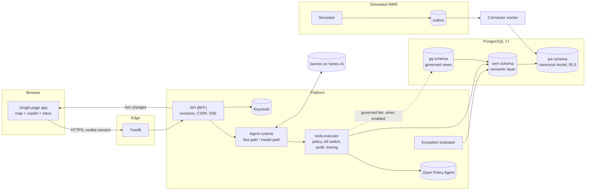
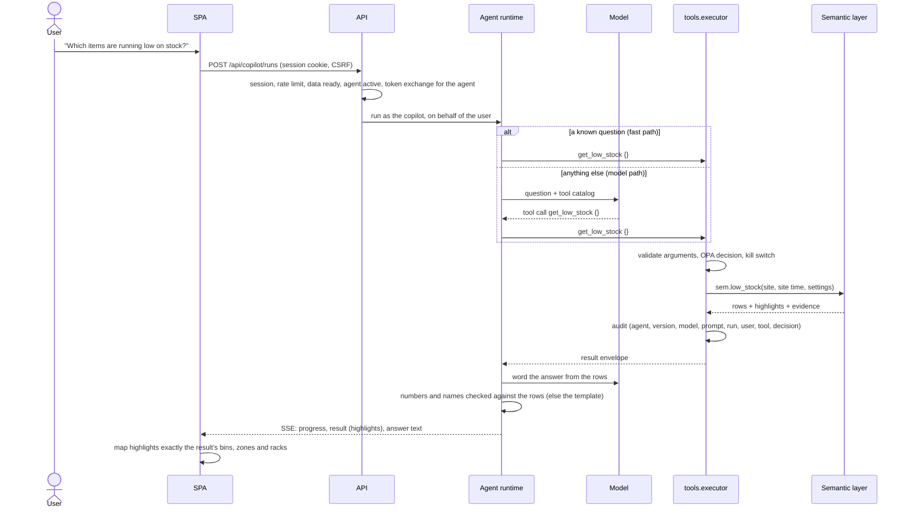

# PalletWise

A warehouse copilot on a live digital twin. Ask a question in plain language; the answer comes from
the warehouse database through governed tools, and the locations it is about light up on a 3D (or
2D) map of the warehouse. One warehouse is simulated end to end: realistic products, zones, racks
and bins, orders, allocations, picks, receipts and 180 days of stock movements.

| | |
|---|---|
| Single-page app | React 19, Vite, React Three Fiber (3D) with an SVG plan (2D) |
| API | Python 3.13, FastAPI as a backend-for-frontend (the browser never holds tokens) |
| Data | PostgreSQL 17 with forced row-level security; a semantic layer of views and functions |
| AI | Gemini on Vertex AI (Flash-Lite), through a governed tool executor |
| Identity and policy | Keycloak (OIDC, token exchange for the agent), Open Policy Agent |
| Simulated WMS | A deterministic simulator that feeds PalletWise through a connector, like a real WMS |

## Run it

Requirements: Docker (about 6 GB of memory for the stack), `make`. For development also `uv` and
`pnpm`.

```bash
cp .env.example .env      # replace every change-me value
make up                   # builds, migrates, simulates 180 days, ingests them; about 5 minutes first time
```

Then open **http://localhost:8080** and sign in as `manager` (or `admin`) with the passwords you set
in `.env` (`KC_DEV_MANAGER_PASSWORD`, `KC_DEV_ADMIN_PASSWORD`).

| What | Where |
|---|---|
| PalletWise | http://localhost:8080 |
| API documentation | http://localhost:8080/api/docs |
| Keycloak (development realm) | http://localhost:8180 |

The copilot needs a Google Cloud project with Vertex AI (`GCP_PROJECT_ID` and `GCP_SA_FILE` in
`.env`). Without them everything else runs, and the copilot answers suggested questions with
template wording.

Frontend work with hot reload: sign in once at port 8080, then `pnpm --filter web dev` and open
http://localhost:5173 (API calls are proxied to the stack).

## A three-minute demo

1. Sign in as `manager`. The **daily brief** and the **inbox** of ranked exceptions are on the right,
   the warehouse on the left; the figures strip under the map shows units, locations, zones, alerts.
2. Ask the assignment's questions (or click the suggestion chips):
   - *Show me the top 5 fastest-moving items.* The five products' pick locations light up.
   - *Which items are running low on stock?* The low-stock pick faces light up, hatched on the map.
   - *Where is product SKU-102 stored?* Every location holding it is pinned; the camera frames them.
   - *Which warehouse zones have the highest stock levels?* The zones are outlined.
   - *Show me items that have not moved in the last 30 days.* Dead stock lights up.
   - Follow-ups use the previous answer: *Of those, which are in zone B?*
3. Switch **Heatmap** on: racks are coloured by picks in the last 7 days.
4. Open **Demo** (the time bar): the guided storyline adds a large outlet order, moves time forward
   4 hours and a week, and the inbox, map and brief change live, without a reload. **Reset** returns
   to the seed.
5. Sign in as `admin` and open **Admin**: the copilot's status and kill switch, usage and estimated
   cost, unanswered questions, and the audit log of every tool call with the agent's identity.

`make storyline` clicks the same demo through automatically in a browser, twice, after a reset.

## Architecture



Every process has its own database role (`pw_app`, `pw_ingest`, `pw_agent_read`, `pw_evaluator`,
`pw_brief`, `pw_admin_read`, `pw_query_read` and more); none can bypass row-level security. The
simulator reaches PalletWise only through the connector, exactly as a real WMS would.

### From a question to highlighted locations



The answer and the highlights come from the same result envelope, so the text, the table and the
map can never disagree. The model never computes a number and never writes SQL for the semantic
layer: it chooses a tool and its arguments, and every number in its wording is checked against the
rows it was given.

### Answer layers

1. **Fast path:** known phrases, suggestion chips, exact SKUs, bins and order numbers go straight to
   a tool; the model only words the answer (or a template does, with no model at all).
2. **Specific tools:** low stock, fast movers, dead stock, slow stock in prime locations, zone
   summary, capacity hotspots, delayed orders, stockout risks, order status, open exceptions,
   locations of a product, contents of a bin.
3. **Query language:** `query_inventory` combines approved measures, dimensions and filters, compiled
   and validated by application code.
4. **Multi-step:** up to five tool calls, follow-ups on the previous answer's identifiers.
5. **Governed SQL (ADR 0002):** the last resort, one read-only `SELECT` over governed views,
   checked by PostgreSQL's own parser and by declared join and measure rules, run read-only with
   hard limits, labelled "Answered with a custom query". Offered to the model only after its
   evaluation gate passes.
6. **Honest decline:** with two or three things the copilot can do instead.

### Security model

- **Identity:** Keycloak signs users in; the API keeps the session server-side (the browser holds
  only an opaque cookie). The copilot acts through a token exchange, as itself, on behalf of the
  user; its scopes are the intersection of the user's and the agent's.
- **Authorization:** every request and every tool call is decided by Open Policy Agent
  (role scopes, site membership, agent scopes, agent status).
- **Data isolation:** forced row-level security on every tenant table; one role per write path.
- **The model's reach:** tools only, through `tools.executor`; no credentials, no SQL, no direct
  database access. Inputs are length-limited and screened; outputs are grounded; markdown is
  sanitized under a strict content security policy.
- **Kill switch and budget:** the Admin can suspend the copilot at once; a daily token budget
  degrades answers to templates instead of failing.
- **Audit:** every tool call, refusal, time shift, reset and admin change, with the agent's
  identity, in a hash-chained audit log.

### Data model and seed

- `db/sql/` and `db/migrations/`: the canonical warehouse model (sites, zones, racks, bins,
  products, customers, orders, lines, allocations, a movement ledger, balances, policies), the
  semantic layer and the governed views. `make up` applies them; `make reset-data` rebuilds.
- `services/simulator/`: the seeded simulated WMS. The same seed always produces the same data;
  its dataset hash is checked against `services/simulator/golden/` on every load.
- The map, the copilot and the inbox read the same semantic functions, and a consistency check in
  the evaluation suite proves they agree for one moment.

### Connecting a real WMS

PalletWise never reads the simulator's tables. The simulator writes records (master data, orders,
allocations, movements, time markers) to an ordered outbox; the connector worker reads them and
applies them through invariant-keeping database functions as `pw_ingest`. A real WMS replaces the
simulator with an adapter that produces the same record stream from its API, change-data capture or
exports, behind the same connector contract (`docs/specs/simulator.md`, `docs/specs/
canonical-warehouse-model.md`). Nothing above the connector changes: the semantic layer, the
copilot, the map and the inbox work as they are. A real site's clock is real time, and the
simulation controls are refused for it.

## Decisions

Architecture decisions are recorded in `docs/adr/` and in each slice's acceptance document.

| Decision | Why |
|---|---|
| Semantic layer owns every calculation; the model only chooses tools | Answers are reproducible and checkable; the model cannot invent a number |
| Tools only through `tools.executor` (policy, kill switch, audit, tracing) | One enforcement point, no shortcuts |
| Backend-for-frontend with server-side sessions | No tokens in the browser |
| Token exchange for the agent, scopes intersected with the user's | The copilot can never do more than its user |
| One database role per write path, forced RLS | A bug in one path cannot write elsewhere or across tenants |
| Simulator behind a connector, not a seed script | The same path a real WMS will use; time and scenarios are real data |
| ADR 0001: one gate for quality, latency and cost together | Improving one never hides a regression in another |
| ADR 0002: governed SQL as a last-resort sixth layer | More questions answered without giving the model the database |
| Time shift instead of a running clock (Slice 4 D2) | A presenter controls the demo; nothing changes under them |
| Reset and time controls for the Manager on simulated sites only | A demo recovers from one screen; a real site has nothing to reset |
| Passwords stay with the identity provider | The sign-in page is the PalletWise-themed Keycloak page |

## Quality

| Command | Runs |
|---|---|
| `make lint` | ruff, pyright (strict), import boundaries, ESLint, Prettier, tsc |
| `make test` | unit, integration against real PostgreSQL 17 and OPA, policy tests |
| `make evals` | the deterministic evaluation gate (104 cases) |
| `make evals-model` | the model gate: three runs per case on the real model, quality, latency and cost |
| `make storyline` | the guided demo clicked through in a browser, twice |

Evidence per slice is in `docs/quality/` (evaluation reports, performance, browser checks).

## Repository

```
apps/web            single-page app (map, copilot, inbox, admin, simulation controls)
services/api        API, agent runtime, tools, semantic layer client, workers
services/simulator  simulated WMS
db                  SQL and migrations
policy              Open Policy Agent policies and tests
evals               evaluation sets, references and gates
docs                product, specifications, ADRs, quality evidence
infra               compose stack, Keycloak realm and theme, Traefik
```

## Known limits

- The governed SQL tier is off until its evaluation gate passes for the deployed configuration
  (`services/api/src/palletwise/semantic/governed_gate.json`); the copilot works without it.
- Proposals and task execution, the full admin panel (users, settings) and audit sealing are
  specified but not built.
- On an 8 GB laptop the full stack runs close to its memory limit; close other applications for a
  live demo.

## Rules for contributors

See [AGENTS.md](AGENTS.md).
