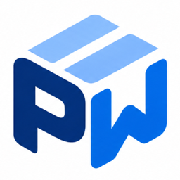
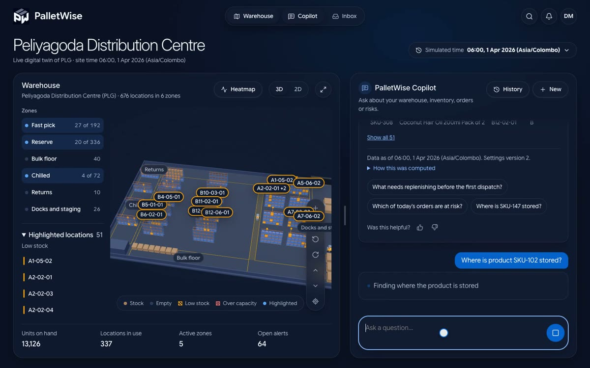
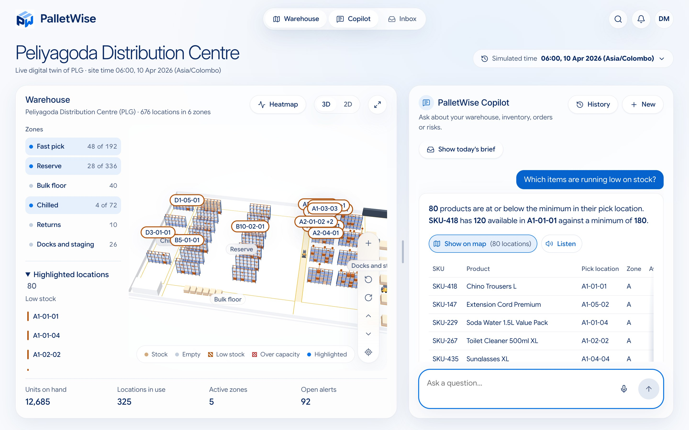
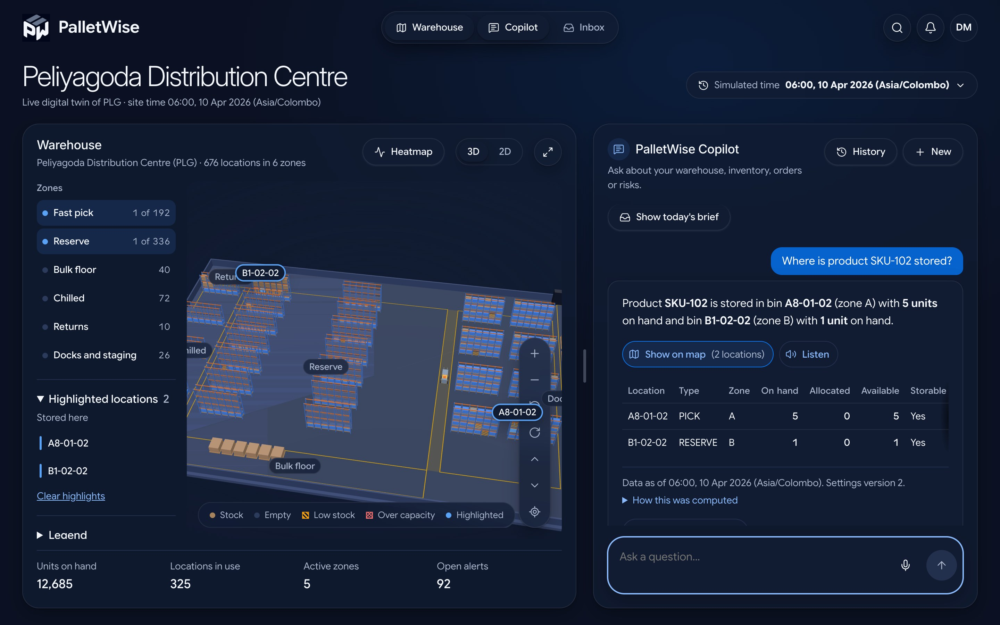
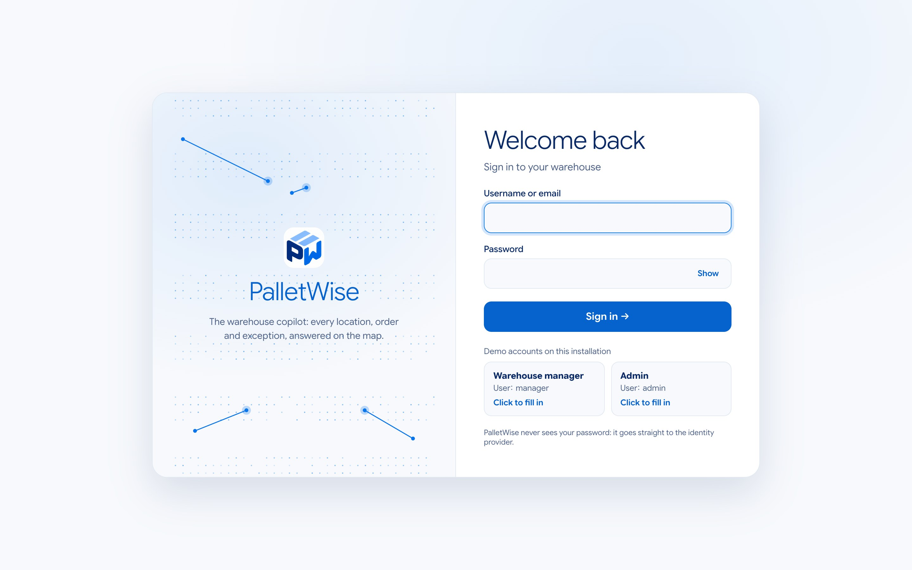
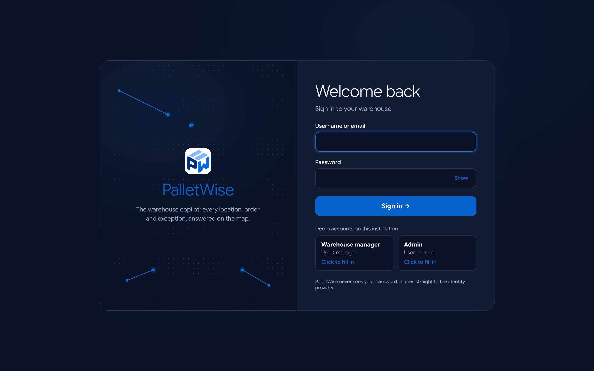
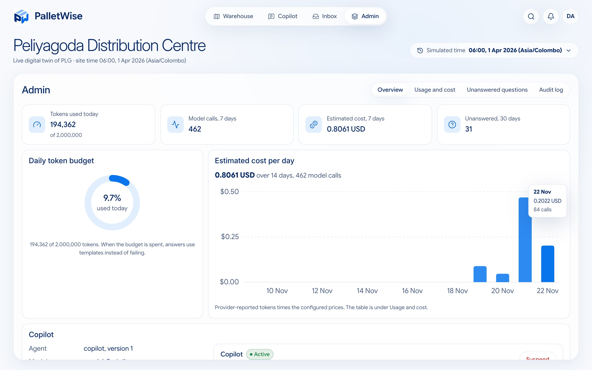
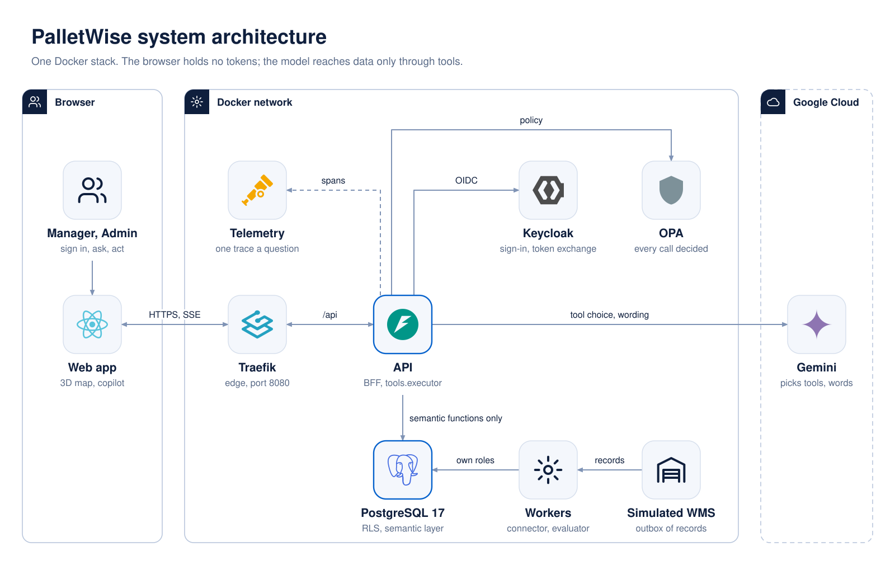
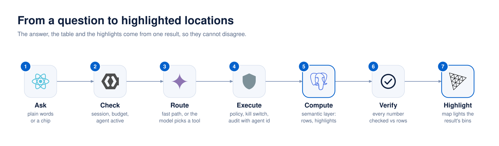
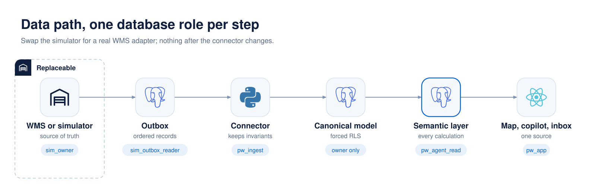

<p align="center">
  <picture>
    <source media="(prefers-color-scheme: dark)" srcset="apps/web/public/brand/logo-dark.png">
    
  </picture>
</p>

<h1 align="center">PalletWise</h1>

<p align="center">The warehouse copilot on a live digital twin: ask in plain language, see the answer on the map.</p>

<p align="center">
  <a href="https://palletwise.oshadhakariyawasam.me"><b>Live demo: palletwise.oshadhakariyawasam.me</b></a>
  &nbsp;·&nbsp;
  <a href="https://github.com/Oxshadha/PalletWise/releases/download/demo-video/palletwise-demo.mp4"><b>Watch the demo video (4 min)</b></a>
</p>

<p align="center">
  <a href="https://github.com/Oxshadha/PalletWise/releases/download/demo-video/palletwise-demo.mp4">
    
  </a>
</p>

## The problem

A warehouse management system records every transaction, but it does not answer the questions a
manager asks every day.

- **Answers are scattered.** "Which items are running low?" means opening several screens and
  combining the results by hand.
- **Reports list bin codes, not places.** The manager still has to work out where B12-06-01 is on
  the floor and what is next to it.
- **Problems surface late.** Low pick faces, dead stock in prime locations and orders at risk are
  found when they already hurt.
- **Generic AI chat is not safe here.** A chatbot that writes its own SQL or invents a number
  cannot be trusted with operational data.

## How PalletWise solves it

| Problem | PalletWise |
|---|---|
| Scattered answers | Ask in plain language; the copilot answers from the warehouse database and shows how each figure was computed and how fresh the data is |
| Bin codes, not places | Every location an answer is about lights up on a 3D or 2D map of the warehouse, and follow-up questions keep that context |
| Problems surface late | A daily brief and an inbox of exceptions ranked by business impact, updated live as the warehouse changes |
| AI that cannot be trusted | The model never sees the database: it chooses governed tools, every calculation lives in a semantic layer, and anything beyond the tools runs only as a parser-checked, read-only query with hard limits; every call is authorised and audited |
| Tied to one WMS | One connector contract; a new WMS is an adapter, and everything above it stays the same |

**The warehouse.** Peliyagoda Distribution Centre: 676 locations in 6 zones, products, customers,
orders, allocations, picks, receipts and 180 days of stock movements. It is a live digital twin:
a deterministic simulator runs the site like a real operation (orders arrive, picks happen, stock
moves, time advances) and feeds PalletWise through the same connector path a real WMS uses. The
same seed gives the same data on every machine.

## Screenshots





<p>
  
  
</p>



## Architecture



## Run it (Windows, macOS, Linux)

You need **Docker Desktop** (or Docker Engine with Compose v2) with about **6 GB of memory** for
Docker, and ports **8080** and **8180** free. Nothing else: no Node, no `make`, no database.

**One command** (with Python 3 installed; on Windows use `py` if `python` is not found):

```bash
git clone <this repository> palletwise && cd palletwise
python scripts/setup.py
```

It creates `.env` with fresh random secrets, writes the demo sign-in cards, builds every image,
starts the stack and waits until everything is healthy: migrations, the warehouse calendar, the
180-day simulation and its ingest. About 5 minutes the first time, under a minute after that.

Every installation loads the same warehouse: the simulator is seeded, so a fresh clone, a
laptop and the live demo all show the same products, orders and movements. The only personal
setting is the model key (below); everything else is generated by setup.

**Without Python, two commands** (PowerShell, bash and zsh alike):

```bash
docker run --rm -v "${PWD}:/w" -w /w python:3.13-alpine python scripts/setup.py --no-start
docker compose up -d --build --wait
```

Open **http://localhost:8080**. The sign-in page shows two demo account cards, **Warehouse
manager** and **Admin**: click one and sign in. The cards fill in the password without showing
it. The accounts are created in Keycloak on first start from the passwords setup generated on
your machine (`KC_DEV_MANAGER_PASSWORD`, `KC_DEV_ADMIN_PASSWORD` in `.env`); nothing is committed.

| What | Where |
|---|---|
| PalletWise | http://localhost:8080 |
| API documentation | http://localhost:8080/api/docs |
| Keycloak (development realm) | http://localhost:8180 |

Stop with `docker compose down` (the data volume is kept); start again with
`docker compose up -d --wait`. With `make` installed, `make setup` and `make up` do the same.

**The model (enter your own key).** The copilot uses Gemini. No key is included in this
repository; each installation brings its own, and it stays in `.env`, which git ignores.

| You have | Do this |
|---|---|
| Nothing yet | Create a free Gemini API key at https://aistudio.google.com/apikey |
| A Gemini API key | Setup asks for it (hidden input). To add or change it later: `python scripts/setup.py --llm` (saves it and restarts what needs it) |
| Google Cloud with Vertex AI | Set `GCP_PROJECT_ID` and `GCP_SA_FILE` (the service account file, kept outside the repository) in `.env`; Vertex AI is used first when both are set |
| No key | Everything else works; the copilot answers the suggested and known questions with template wording |

Both options run the Gemini models the copilot was evaluated with. Another provider plugs in
through the same provider interface, after its own evaluation run.

**Troubleshooting.**
- A 502 on port 8080 in the first minutes: Keycloak is still starting (up to two minutes on a
  laptop under memory pressure); `--wait` returns once it is healthy.
- A sign-in page left open for more than 10 minutes, or the browser's back button after signing
  in, uses an expired sign-in link; PalletWise starts a fresh sign-in by itself.
- Something not healthy: `docker compose ps` shows which service, `docker compose logs <service>`
  shows why.

## Try it

1. Sign in as **Manager**. The daily brief and the ranked exception inbox are on the right, the
   warehouse on the left, and the figures strip under the map shows units, stocked locations,
   active zones and open alerts.
2. Ask the assignment's questions, or click the suggestion chips:
   - *Show me the top 5 fastest-moving items.* Their pick locations light up.
   - *Which items are running low on stock?* The low pick faces light up.
   - *Where is product SKU-102 stored?* Every location holding it is pinned and framed.
   - *Which warehouse zones have the highest stock levels?* The zones are outlined.
   - *Show me items that have not moved in the last 30 days.* Dead stock lights up.
   - Follow-ups use the previous answer: *Of those, which are in zone B?*
3. Switch **Heatmap** on: racks are coloured by units picked in the last 7 days, in 3D and 2D.
   The focus button beside 3D and 2D gives the map its whole panel; drag the bar between the
   map and the copilot to resize them, or click **Copilot** in the top bar to hide it.
   Ask by voice with the microphone in the question box (the words appear as you speak), and
   press **Listen** on an answer to hear it read aloud.
4. Open **Demo**: the guided storyline adds a large outlet order and moves time forward 4 hours,
   then a week. The inbox, the map and the brief change live, with no reload. **Reset** returns to
   the seed.
5. Sign in as **Admin** and open **Admin**: the copilot's status and kill switch, usage and
   estimated cost, unanswered questions, and the audit log of every tool call with the agent's
   identity (CSV export).

## How a question becomes highlighted locations



1. **Ask.** The browser posts the question with its session cookie and CSRF token. The browser
   never holds an access token.
2. **Check.** The API checks the session, the rate limit, that the data is ready and the agent is
   active, then exchanges the user's token for the copilot's own token, on behalf of the user.
3. **Route.** Known phrasings, suggestion chips and exact identifiers (a SKU, a bin, an order
   number) go straight to a tool (the fast path). Anything else goes to the model, which only
   chooses a tool and its arguments.
4. **Execute.** Every call goes through `tools.executor`: argument validation, an Open Policy Agent
   decision (role, site, agent scopes), the kill switch, and an audit record naming the agent, its
   version, the model, the prompt version, the run and the user.
5. **Compute.** The tool calls one semantic-layer function at the site's clock. It returns rows,
   the bins, racks and zones to highlight, and the evidence of how it was computed.
6. **Verify.** The model words the answer from the rows. Every number, SKU, bin and zone in the
   wording must appear in those rows; if not, a template answer is shown instead.
7. **Highlight.** The result streams to the browser over SSE. The answer text, the table and the
   map highlights come from the same result envelope, so they cannot disagree.

### Answer layers

| Layer | What answers | Model's part |
|---|---|---|
| Fast path | Known questions, chips, exact identifiers | Wording only, or none (template) |
| Specific tools | Low stock, fast movers, dead stock, slow stock in prime locations, zone summary, capacity hotspots, delayed orders, stockout risks, order status, open exceptions, product locations, bin contents | Picks the tool |
| Query language | `query_inventory`: approved measures, dimensions and filters, compiled and validated by code | Picks measures and filters |
| Multi-step | Up to five tool calls; follow-ups on the previous answer's identifiers | Plans the calls |
| Governed SQL | Questions no tool covers, as one read-only `SELECT` over governed views, checked by a parser guard and run with hard limits | Writes the query; the guard and the database decide what runs |
| Honest decline | Says what it cannot answer and offers two or three things it can | None |

## Data path



PalletWise never reads the simulator's tables. The simulator writes ordered records (master data,
orders, allocations, movements, time markers) to an outbox. The connector applies them through
invariant-keeping database functions as `pw_ingest`. A real WMS replaces the simulator with an
adapter that produces the same record stream from its API, change data capture or exports. Nothing
after the connector changes. A real site's clock is real time, and the simulation controls are
refused for it.

- **`pw` schema:** the canonical warehouse model, with forced row-level security on every tenant
  table and a movement ledger.
- **`sem` schema:** the semantic layer. Every business calculation lives here, once. The map, the
  copilot, the brief and the inbox all read it, and an evaluation check proves they agree.
- **`gq` schema:** read-only governed views with declared semantics, for the governed SQL layer.
- **The seed is deterministic.** The same seed always produces the same data; its dataset hash is
  checked against `services/simulator/golden/` on every load.

### Connecting a third-party WMS

**Design (ADR 0003).** PalletWise never depends on a WMS's database or API directly. Every WMS is
translated into PalletWise's own canonical model at the edge, so the semantic layer, the copilot,
the map and the inbox never change when the WMS does. It works like a protocol: one contract that
every warehouse speaks, and one adapter per kind of source behind it.

| Layer | Per WMS | Responsibility |
|---|---|---|
| Mapping file | Yes | For a REST WMS: its endpoints, authentication, paging, and which source field becomes which canonical field, with types, code tables and unit conversions |
| Connector (`palletwise.connectors`) | No | The `WmsConnector` contract (`pull(cursor, limit)`, `health()`), a registry of connector kinds, and the REST connector that reads any mapped API with per-stream cursors and retries that honour `Retry-After` |
| Connector worker and ingest | No | Applies canonical records strictly in order and in batches as `pw_ingest`, through invariant-keeping database functions; idempotent on natural keys, so a replay creates nothing twice |

**Plugging in a WMS with a REST API** is a mapping file. The sample `acme-wms.yaml` maps an API
with different names, grams, cubic centimetres and short status codes onto exactly the records
the simulator produces:

```yaml
source_system: acme-wms
base_url: https://wms.acme.example/api/v2
auth: { type: bearer, env: ACME_WMS_TOKEN }
paging: { style: cursor, param: pageToken, size_param: pageSize, next: paging.nextToken }
streams:
  - record_type: PRODUCT
    path: /items
    items: results
    id: itemId
    occurred_at: modifiedAt
    since_param: modifiedSince
    fields:
      sku: { path: itemCode, as: upper }
      name: description
      unit_weight_kg: { path: weightGrams, as: float, scale: 0.001 }
      temperature_class: { path: storage, values: { amb: AMBIENT, chl: CHILLED, frz: FROZEN } }
```

```python
from palletwise.connectors import build

connector = build({"kind": "rest", "mapping": "acme-wms"})
batch = connector.pull(cursor=None, limit=500)  # canonical records, oldest first, and a cursor
```

**Why this way.**
- Ordered, idempotent records survive retries, restarts and replays without double counting.
- Least privilege: the connector holds the only WMS credential, from its environment;
  `pw_ingest` can write only through the ingest functions.
- Write-back is explicit: approved tasks go back through `submit_task` with an idempotency key,
  and PalletWise treats a task as done only when its result record arrives.
- A new kind of source (change data capture, file drops) registers as another connector kind
  behind the same contract.

The simulator (`services/simulator`) feeds PalletWise through this same contract, exactly as a
real WMS does.

## Security model

| Concern | How |
|---|---|
| Identity | Keycloak (OIDC). The API is a backend for frontend: sessions are server side and the browser holds an opaque cookie. Passwords stay with the identity provider; the sign-in page is a PalletWise Keycloak theme. |
| The agent's identity | Token exchange: the copilot acts as itself on behalf of the user, with the intersection of the user's and the agent's scopes. Every action is traceable to agent id and version, run and user. |
| Authorization | Open Policy Agent decides every request and every tool call. |
| Data isolation | Forced row-level security; one database role per write path (`pw_app`, `pw_ingest`, `pw_agent_read`, `pw_evaluator`, `pw_brief`, `pw_admin_read`, `pw_query_read` and more). None can bypass RLS. |
| The model's reach | Tools only, through `tools.executor`, with no credentials and no database connection. SQL only through the governed layer: parser-checked, read-only governed views, hard limits. Inputs are length limited and screened; outputs are grounded; markdown is sanitized under a strict content security policy. |
| Kill switch and budget | The Admin suspends the copilot at once. A daily token budget degrades answers to templates instead of failing. |
| Audit | Every tool call, refusal, time shift, reset and admin change, in a hash-chained log. |
| Secrets | None in the repository, logs or traces. Setup generates them per machine. |

## Governed SQL: an extension measured into production

The answer layers above handle the questions they were designed for. For questions beyond them,
the copilot may write one read-only `SELECT` over governed `gq` views (ADR 0002). The model never
gets the database: a PostgreSQL 17 parser guard (`pglast`) checks the whole query tree against an
allowlist and declared join and measure rules, a read-only role sees only the governed views,
hard limits apply (2 s, 200 rows, a cost cap), and every query is audited with the agent's
identity. Answers are labelled as custom queries.

**Measured on 30 questions beyond the tools** (three runs each, real model):

| | Tools and query language | With the governed AI tool |
|---|---|---|
| Right answer | about 7% | **93%** |
| Right when it answers | not measured | **96.6%** |
| Safe (no wrong number) | about 63% | **95.6%** |
| Questions the tools answer: right tool | 100% | **100%** (unchanged) |

**How it got there.** Each run was diagnosed case by case and the cause fixed in the design:

| Run | Change | Right answers |
|---|---|---|
| 1 | First design | 49% |
| 2 | Evaluation budget, tool wording | 63% |
| 3 | Room for longer queries; harness fixes | 73% |
| 4 | A safety-first gate; the evaluation stops throttling itself; counting and `HAVING` rules | 82% |
| 5 | The catalog shows each column's allowed values (`RESERVE`, not `reserve`); query errors become a correction the model makes once | **93%** |

These questions are outside what the tools and the query language were built for: without the
governed layer they end in a decline or in real numbers for a nearby question (units on hand
instead of a count of products). With all three layers, the copilot answers them and keeps every
other answer exactly as it was. The configuration is recorded in `semantic/governed_gate.json`
with its report, accepted by the product owner, and on by default; the Admin can switch it off.

## Latency

Measured with the same model gate (ADR 0001):

| What | Before | After |
|---|---|---|
| Model answers, slowest | 19.2 s (90th percentile), worst run 43 s | 7.3 s (95th percentile) |
| First text on screen | 17.6 s | progress within 0.1 s, headline streamed before the full answer |
| Exception engine, full evaluation at 180 days | 2.1 s | 0.14 s |

The model answers got faster through the fast path for known questions, a hedged backup call when
the primary model is slow, deadlines per stage, and streaming; the exception engine through turning
PostgreSQL JIT compilation off for its two functions. Reports: `docs/quality/eval-reports/`.

## Decisions

Architecture decisions are in [`docs/adr/`](docs/adr/); slice decisions are in each
`docs/specs/slice-N-acceptance.md`.

| Decision | Why |
|---|---|
| The semantic layer owns every calculation; the model never computes | Answers are reproducible and checkable; the model cannot invent a number |
| Every tool call through one executor (policy, kill switch, audit, tracing) | One enforcement point, no shortcuts |
| Backend for frontend with server-side sessions | No tokens in the browser |
| Token exchange for the agent, scopes intersected with the user's | The copilot can never do more than its user |
| One database role per write path, forced RLS | A bug in one path cannot write elsewhere or across tenants |
| Simulator behind a connector, not a seed script | The same path a real WMS uses; time and scenarios are real data |
| ADR 0001: one gate for quality, latency and cost together | Improving one never hides a regression in another |
| Fast path before the model | Known questions answer in milliseconds and work with no model at all |
| Working sets carry provenance and re-query current data (Slice 2) | Follow-ups never answer from stale values |
| Input classifier is an extra layer, never the boundary (Slice 2) | A classifier can be wrong; OPA, validation and grounding are the boundary |
| Live site stream over SSE with a durable per-site change sequence (Slice 3) | Map, inbox and brief update live; a lost event triggers a full refetch |
| Exceptions evaluated once per state change, ranked by impact (Slice 3) | The inbox ranks by business impact, not by when something happened |
| One daily brief per site and day, stored (Slice 3) | One model call a day, the same brief for everyone, template without a model |
| Search is a read endpoint, not a copilot tool (Slice 3) | Instant and exact; choosing a result runs the copilot through the executor |
| The simulator owns time; a time shift, not a running clock (Slice 4) | The presenter controls the demo; nothing changes under them |
| Reset and time controls for the Manager, on simulated sites only (Slice 4) | A demo recovers from one screen; a real site has nothing to reset |
| One operation at a time per site (Slice 4) | A shift, a scenario step and a reset can never interleave |
| ADR 0002: governed SQL as the last answer layer, enabled by measured results (Slice 5) | Questions beyond the tools get answered without giving the model the database |
| ADR 0003: WMS connectors, one contract and declarative adapters | A new warehouse system is a mapping file, and everything above the connector stays the same |

## Quality

| Command | Runs |
|---|---|
| `make lint` | ruff, pyright (strict), import boundaries, ESLint, Prettier, tsc |
| `make test` | unit tests, integration tests against real PostgreSQL 17 and OPA, policy tests |
| `make evals` | the deterministic evaluation gate |
| `make evals-model` | the model gate: three runs per case on the real model, for quality, latency and cost |
| `make storyline` | the guided demo, clicked through in a browser twice |

Evidence per slice (evaluation reports, performance, browser checks) is in
[`docs/quality/`](docs/quality/).

## Repository

```
apps/web            single-page app: map, copilot, inbox, admin, simulation controls
services/api        API, agent runtime, tools, semantic layer client, workers
services/simulator  simulated WMS
db                  SQL and migrations
policy              Open Policy Agent policies and tests
evals               evaluation sets, references and gates
docs                product, specifications, ADRs, architecture diagrams, quality evidence
infra               compose stack, Keycloak realm and theme, Traefik
scripts             first-time setup
```

Contributor rules: [AGENTS.md](AGENTS.md).
