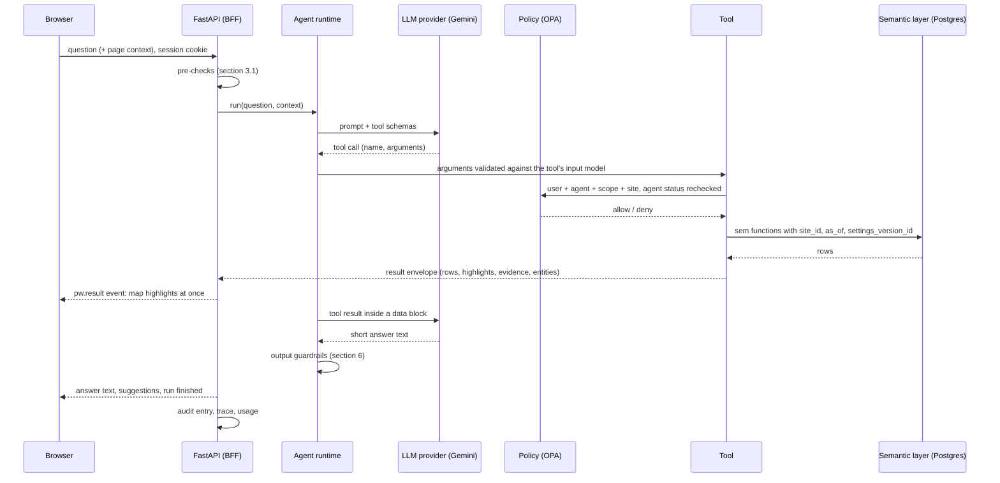

# Agent, Tools and API

| | |
|---|---|
| Status | Approved (2026-11-18, revision 2) |
| Owner | Product owner |
| Last updated | 2026-11-18 |
| Implements | FR-COP, FR-MAP-04 to FR-MAP-08, FR-PRP-01 to FR-PRP-08, FR-ADM-02, FR-ADM-03, NFR-SEC-01, NFR-SEC-02, NFR-REL, NFR-CST, NFR-OBS in [requirements.md](../product/requirements.md) |
| Consumes | [canonical-warehouse-model.md](canonical-warehouse-model.md), [semantic-layer-and-query-dsl.md](semantic-layer-and-query-dsl.md) |

## 1. Scope

How a question becomes an answer with map highlights: request flow, answer paths, the tool registry, the agent runtime, guardrails, identity on each call, proposals, the API, streams and the visualization contract. Business calculations are not defined here; they belong to the semantic layer.

**Single source for shared definitions.** Tools, highlight reasons, severities and their mappings are defined once in code (the `contracts` package) and generate the agent's tool schemas, the OpenAPI document, the frontend types and the evaluation metadata. No second, hand-edited list exists anywhere.

## 2. End-to-end flow (model path)

**Highlights appear as soon as the tool returns**, before the model writes its text (FR-COP-09).

## 3. Answer paths

### 3.1 Pre-checks, in this order

1. Session valid, rate limit not exceeded.
2. Site `data_status` is `READY` (CWM 5.2). During a simulation reset the site stays `REBUILDING` until the new run is `ACTIVE` (CWM 7.4), so no operational request runs on partial data.
3. Agent status is active. If suspended, every copilot request is refused, fast path included (FR-ADM-03).
4. Model availability and budget decide which path below can be used. They never bypass checks 1 to 3.

### 3.2 The three execution paths

| Path | Used when | Tool chosen by | Answer text written by | Works with no model? |
|---|---|---|---|---|
| A. Fast path, model wording | a suggestion, brief link or deterministic pattern matches, and Flash-Lite is available within budget | the router (`copilot/fast_path.yaml`: exact SKU, bin code, order number, fixed phrases) | Flash-Lite, one or two sentences | no |
| B. Fast path, template wording | same match, but no model is available or the budget is used up | the router | a deterministic template per tool, filled from the result envelope | **yes** |
| C. Model path | no fast-path match, primary model available within budget | the primary model, at most 5 tool calls | the primary model | no |

If neither A, B nor C applies (no match and no model), the copilot says it can answer suggested questions only and shows the suggestion chips. All three paths send the same events (section 9), so the UI does not change behaviour between them. Every run records its path (FR-COP-02).

### 3.3 Decline

Out-of-scope or unsupported questions, or a run whose tool attempts were all rejected, end with a decline: the reason, two or three supported alternatives as suggestions, and a log entry for the Admin "Unanswered questions" view (FR-COP-08).

## 4. Tool registry

Every tool is declared once:

| Field | Meaning |
|---|---|
| `name` | stable identifier |
| `description` | what the model sees; states what the tool answers and what it does not |
| `input_model` | Pydantic model; every field typed and bounded; mutually exclusive fields enforced |
| `scope` | permission required, e.g. `inventory.read`, `orders.read`, `proposal.create` |
| `side_effect` | `read` or `propose`; no tool can approve, submit or execute |
| `handler` | calls the semantic layer and returns the result envelope |
| `template` | deterministic answer template for path B |
| `rate_limit` | per user per minute |

### 4.1 v1 tools

| Tool | Inputs | Scope | Side effect |
|---|---|---|---|
| `find_product_locations` | exactly one of `sku`, `product_query` | inventory.read | read |
| `get_bin_contents` | `bin_code` | inventory.read | read |
| `get_low_stock` | `zone?`, `category?`, `limit` | inventory.read | read |
| `get_top_movers` | `last_days` (1 to 365, default 30), `limit` (1 to 50, default 5), `category?` | inventory.read | read |
| `get_dead_stock` | `limit`; the period always comes from site settings | inventory.read | read |
| `get_zone_summary` | `metric`: `on_hand`, `stock_value` or `utilization_pct` | inventory.read | read |
| `get_order_stockout_risks` | exactly one of `horizon_hours` (1 to 72) or `until_first_dispatch_window: true` | orders.read | read |
| `get_delayed_orders` | `limit` | orders.read | read |
| `get_capacity_hotspots` | none; the threshold always comes from site settings. Custom thresholds ("zones above 80 percent") go through `query_inventory`, so the exception rule is never contradicted. | inventory.read | read |
| `get_festival_risks` | `category?`, `limit` | inventory.read | read; returns the projection outcome (`RISK`, `NO_RISK_THROUGH_FESTIVAL`, `UNKNOWN_BEYOND_DATA`) per semantic spec 5.2 |
| `query_inventory` | DSL request (semantic spec 7) | inventory.read, orders.read as needed | read |
| `propose_replenishment` | `sku`, `to_bin_code?`, `qty?`, `exception_id?` | proposal.create | propose |
| `propose_cycle_count` | `bin_code`, `exception_id?` | proposal.create | propose |

## 5. Agent runtime

- **Framework**: Pydantic AI behind an `AgentRuntime` interface; models behind an `LLMProvider` interface. Neither leaks into tools or the semantic layer.
- **Models**: primary Gemini Flash (3.8 Flash candidate, confirmed by NFR-QLT-03); Flash-Lite for path A wording and the input classifier; fallback model from the agent registry.
- **Prompt**: `copilot/prompts/system.v{n}.md`, versioned; the version is recorded on every run; changes pass the evaluation gate.
- **Limits per run**: at most 5 tool calls, a token cap, low temperature, a per-call timeout and a total run timeout.
- **Context given to the model** (context only, never used for authorization, which always uses the verified server-side identity of section 7):
  - user role, site name, `as_of`, page context (selected bin, zone or exception)
  - the working set as typed labels, not values
  - conversation history: the last 6 turns of user questions and answer texts, at most 2,000 tokens, older turns dropped. Tool results from earlier turns are not resent; follow-ups re-query (FR-COP-06). History is placed inside the data block.
  - tool results, inside the data block
- **Data block**: everything that is not the system prompt or the current question is passed inside a delimited block marked as data, with the instruction that nothing inside it is an instruction. Product names, notes, order text and earlier answers are therefore never obeyed (FR-COP-12).
- **What the model returns**: only short answer text. It never produces highlights, numbers that are not in results, suggestions or SQL.

## 6. Guardrails

Security is enforced by deterministic boundaries. The classifier helps decide whether to decline politely; it never grants or removes a permission.

| Stage | Check | On failure |
|---|---|---|
| Input | length at most 1,000 characters; Unicode normalized; rate limit | rejected with a message |
| Input | Flash-Lite classifier: out of scope or injection attempt (**advisory**) | polite decline; logged |
| Every tool call | agent status active (kill switch rechecked per call, so a suspension stops a run within one step) | run stopped with the suspension message |
| Every tool call | arguments validated against `input_model` | error returned to the model, counts as a step |
| Every tool call | policy decision (section 7) | denied, audited, the model is told it is not permitted |
| Data access | only `sem` functions, as the tool's database role; no SQL from the model (semantic spec 7.4) | not possible by construction |
| Output | numeric grounding (6.1) | text regenerated once, then replaced by the tool's template answer |
| Output | every SKU, bin, zone and order named in the text appears in the results or the question | same as above |
| Output | em and en dashes replaced (FR-COP-13) | normalized, never rejected |
| Render | markdown sanitized, no raw HTML, strict CSP (NFR-SEC-06) | not rendered |

### 6.1 Numeric grounding rules

1. Extract every number from the answer text: integers, decimals, percentages, currency amounts and dates.
2. Normalize: remove thousands separators and currency symbols; treat "12%" as 12 with unit percent; parse dates to ISO.
3. A number is grounded if it equals, after rounding to the precision shown in the text, a value in the result rows or evidence; or equals a row count or `truncated` limit of a result; or appears in the user's own question (for example "last 30 days"); or is a date present in the evidence.
4. Signs must match: a negative value is grounded only by a negative value.
5. Anything else fails the check.

## 7. Identity and authorization on every call

1. The BFF holds the user's session; the browser has only a cookie (FR-AUTH-02).
2. For each copilot run, on every path, the API exchanges the user's token with Keycloak for a token with `sub` = the user and `act` = the copilot client.
3. Policy input per tool call: user (subject, role, sites from verified claims), agent (id, version, status, allowed scopes from the registry, read at call time), action (tool, scope), resource (site).
4. OPA allows the call only when the user's role grants the scope **and** the agent's allowed scopes include it **and** the agent is active (NFR-SEC-02).
5. Database role per side effect: `pw_agent_read` for reads; a propose tool additionally calls `create_proposal()` as `pw_proposal_writer` (section 8).

## 8. Proposals

### 8.1 Drafting (propose tools)

**Replenishment target and quantity**, computed by the semantic layer, never by the model:

- **Destination**: `to_bin_code` if given (must be the product's `PICK` bin in its replenishment policy), otherwise the policy's pick bin. No policy and no destination: the tool declines with a reason.
- **Source**: among active `RESERVE` and `BULK` bins holding the product with `available > 0`, the one with the most available stock; ties broken by shortest distance between bin centres, then by bin code.
- **Quantity**: `qty` if given, otherwise `max_qty - pick bin on_hand` from the policy (or the stockout shortfall if there is no policy), then capped by the source's `available` and by the destination's remaining volume and weight capacity. A quantity of 0 after capping declines with the reason.
- The tool is offered only when the shortage is **fixable by replenishment** (semantic spec 6). A true shortage gets no replenishment suggestion.

**Insertion without stale evidence.** The tool reads evidence as `pw_agent_read`, then calls `create_proposal(evidence, ...)` as `pw_proposal_writer`. That function, in its own transaction:

1. re-reads the current balances of every bin and product in the evidence;
2. if any differs, inserts nothing and returns `EVIDENCE_CHANGED`; the tool re-reads once and retries, then reports the change to the user;
3. otherwise inserts the proposal with status `PENDING`, the evidence snapshot, its `as_of`, `settings_version_id` and the balances it confirmed, and the first transition.

### 8.2 Approval and rejection contract

| Rule | Detail |
|---|---|
| Permission | `proposal.approve` and `proposal.reject`, granted only to `warehouse_manager`, checked by OPA on every request (FR-PRP-04). Admin and the agent are refused. |
| Scope | the proposal must belong to the caller's tenant and an allowed site |
| Concurrency | the request carries the proposal's `row_version`; a mismatch returns `409 Conflict` with the current state |
| State | only `PENDING` can be approved or rejected; `EXPIRED`, decided or stale proposals return `409` with the reason |
| Staleness | evaluated per CWM 9.3; a stale proposal returns `409 STALE` with the differences, and the Manager confirms again with the new `row_version` |
| Idempotency | the request carries an `Idempotency-Key`; repeating it returns the original outcome |
| Rejection | a reason is required |
| Effect of approval | status becomes `APPROVED` and a transition is recorded. A workflow worker then submits the task to the connector, moving it to `SUBMITTED`; the connector's result moves it to `EXECUTED` or `FAILED` (FR-PRP-08 to FR-PRP-13). **Approval never changes inventory.** |
| Audit | every decision, conflict and refusal is audited |

## 9. Streams

### 9.1 Copilot run stream

The run response is an event stream using AG-UI event types plus PalletWise events.

| Event | Content |
|---|---|
| `RUN_STARTED` | run id, path (A, B or C) |
| `pw.status` | live progress (ADR 0001): `stage` (`reading`, `checking`, `reviewing`, `writing`) and a plain-language `label` from a fixed list per stage and per tool, sent first and before each step. Never model reasoning, prompts, tool names, arguments or identifiers. |
| `TOOL_CALL_START`, `TOOL_CALL_END` | tool name and normalized, already-authorized arguments, for traces and the Admin audit view; the Manager sees the plain-language "how computed" explanation instead (UX spec 7) |
| `pw.result` | the result envelope (semantic spec 7.5), including highlights |
| `pw.headline` | headline first (ADR 0001 section 6, when enabled): the exact template headline of the latest result, sent once when the answer is not written by the headline deadline (3 s after the run starts). The answer text that follows replaces it; model wording is shown only when it keeps every key fact of its result, otherwise the answer text is the template. |
| `TEXT_MESSAGE_START`, `TEXT_MESSAGE_CONTENT`, `TEXT_MESSAGE_END` | answer text |
| `pw.suggestions` | suggestions (section 11) |
| `RUN_FINISHED` | run id, trace id, final path, card outcome, and `text_source`: `model`, `template` or `message` (who wrote the answer text, for traces and the evaluation; ADR 0001) |
| `RUN_ERROR` | user-safe message, error code, trace id |

**Reliability rules**

- Events of a run carry a sequence number; the client ignores duplicates and out-of-order events.
- If the client disconnects, the server **cancels the run** after a 10-second grace period, stopping model calls so no tokens are spent on an answer nobody sees. Explicit cancel (FR-COP-10) stops it immediately.
- A completed run is stored in the conversation (FR-COP-11). After a reconnect the client loads the conversation instead of replaying the stream.

### 9.2 Site live stream

`GET /sites/{id}/events` tells the browser that something changed: inventory, exceptions, proposals, clock or `data_status`.

- Events are **invalidation hints, not data**. The truth is always the snapshot endpoints (`map-state`, `exceptions`, `proposals`, `brief`).
- Database changes `NOTIFY` a channel per site; each API instance `LISTEN`s and forwards hints to its connected clients. Each hint carries a per-site sequence number and the kinds of data that changed.
- On connect, on reconnect, or when the client sees a gap in sequence numbers, it **refetches the snapshots** it displays. A lost notification therefore costs at most a refetch, never a wrong screen, which is why no durable event outbox is needed in v1.
- The client batches hints for about 500 ms before refetching.

## 10. Visualization contract

| Element | Shape |
|---|---|
| highlight | `{target_type: bin, rack or zone, target_id, reason, severity}` |
| focus | bounding box of all highlighted targets, computed by the frontend from layout geometry |

**Reasons and default severities**, defined once in `contracts`:

| Source | Reason | Severity |
|---|---|---|
| DSL query | `query` | `info` |
| product location | `location` | `info` |
| top movers | `fast_mover` | `info` |
| `LOW_STOCK` | `low_stock` | `warning` |
| `STOCKOUT_RISK` | `stockout_risk` | `critical` for a true shortage or due within 4 hours, otherwise `warning` |
| `DELAYED_ORDER` | `delayed_order` | `critical` |
| `DEAD_STOCK` | `dead_stock` | `info` |
| `SLOW_IN_PRIME` | `slow_in_prime` | `warning` |
| `CAPACITY_HOTSPOT` | `capacity` | `critical` if any bin is over capacity, otherwise `warning` |
| `FESTIVAL_SHORTAGE` | `festival_risk` | `critical` if the stock-out is within 3 days, otherwise `warning` |
| pending proposal | `proposal` | `info` |

The exception inbox, the map and answer cards all use this table, so one exception never shows two different severities. The frontend maps each reason to a style (colour plus pattern or icon, FR-MAP-03) and draws exactly the highlights it receives (FR-MAP-04), in both 2D and 3D.

## 11. Suggestions

Generated by rules from the result type and page context, never by the model (FR-COP-07). Each carries a tool and parameters. **The server treats a selected suggestion as untrusted input**: it is validated against the tool's input model and authorized exactly like any other call.

| After | Suggestions, with the tool each uses |
|---|---|
| product location | "How many days of cover does it have?" (`query_inventory`: `days_of_cover` by product, working set), "Show its demand over the last 30 days" (`query_inventory`: `demand_units` by day), "What else is in this bin?" (`get_bin_contents`) |
| low stock | "Which orders does this affect?" (`get_order_stockout_risks`), "Propose replenishment" (`propose_replenishment`, only if fixable) |
| top movers | "How many days of cover do these have?" (`query_inventory`: `days_of_cover` by product, working set), "Where are they stored?" (`query_inventory`: `on_hand` by product and bin, working set) |
| dead stock | "Total value of these items" (`query_inventory`: `stock_value`, working set), "Where are they stored?" (as above) |
| stockout risk | "Propose replenishment" only if fixable; "Show delayed orders" (`get_delayed_orders`) |
| festival risk | "Propose replenishment" (only if fixable), "Show days of cover for this category" (`query_inventory`: `days_of_cover` by category) |
| bin selected on the map | "What is in this bin?" (`get_bin_contents`), "Propose a cycle count" (`propose_cycle_count`) |

A test runs every suggestion rule against fixtures and confirms that each suggestion executes successfully (FR-COP-07).

## 12. API

All endpoints are under `/api`, documented by OpenAPI; frontend types are generated from it (NFR-COD-04).

| Endpoint | Purpose |
|---|---|
| `POST /copilot/runs` | start a run; event stream response (9.1) |
| `POST /copilot/runs/{id}/cancel` | cancel a run |
| `GET /copilot/conversations`, `GET /copilot/conversations/{id}` | history |
| `POST /copilot/runs/{id}/feedback` | rating and comment |
| `GET /sites/{id}/layout` | zones, racks, bins, features with geometry |
| `GET /sites/{id}/map-state` | per-bin state flags from the semantic layer |
| `GET /sites/{id}/bins/{code}` | bin details |
| `GET /sites/{id}/events` | live invalidation stream (9.2) |
| `GET /sites/{id}/brief` | daily brief |
| `GET /sites/{id}/exceptions`, `POST .../{id}/acknowledge` | inbox |
| `GET /sites/{id}/proposals`, `POST .../{id}/approve`, `POST .../{id}/reject` | proposals (8.2) |

Admin endpoints are specified with the Admin slice.

### 12.1 Common error contract

Errors use the Problem Details format (RFC 9457) with a stable `code` and the `trace_id`.

| Status | Codes | When |
|---|---|---|
| 401 | `UNAUTHENTICATED` | no or expired session |
| 403 | `FORBIDDEN` | policy denied |
| 404 | `NOT_FOUND` | resource absent or outside the caller's tenant (never revealed as forbidden) |
| 409 | `VERSION_CONFLICT`, `STALE`, `INVALID_STATE`, `EVIDENCE_CHANGED` | concurrency, staleness, lifecycle |
| 422 | `VALIDATION_FAILED` | input model or DSL validation |
| 429 | `RATE_LIMITED` | with `Retry-After` |
| 503 | `DATA_NOT_READY`, `COPILOT_SUSPENDED`, `MODEL_UNAVAILABLE` | pre-checks (3.1) |
| 504 | `TIMEOUT` | a call exceeded its time limit |

State-changing endpoints (`approve`, `reject`, `acknowledge`, `cancel`, `feedback`) accept an `Idempotency-Key`.

## 13. Audit, tracing and usage

- One trace per run with spans for the API, routing, each model call (GenAI attributes), each policy decision, each tool and each database call (NFR-OBS-01).
- Personal data is **masked in the API process before export** to Langfuse (NFR-PRV-01); the browser plays no part in it. In production, prompt and response text are not exported (NFR-PRV-02); only metadata, token counts and timings are.
- One audit entry per tool call with the fields in NFR-AUD-02, one per run outcome, and one per proposal decision.
- One usage record per model call: tokens, estimated cost, latency, model (NFR-CST-01).

## 14. Acceptance for slices 1 and 2

| Check | Slice |
|---|---|
| "Where is product SKU-102 stored?" returns locations and highlights the right bins in 2D and 3D | 1 |
| The same question through a chip uses path A; with the model disabled it uses path B and still answers | 1 |
| A role or agent without `inventory.read` is denied and audited | 1 |
| Trace shows every span; audit entry has every field; no prompt text exported in production configuration | 1 |
| The five assignment questions pass in the evaluation suite with correct highlights | 2 |
| Indirect injection in a product name is not obeyed | 2 |
| Kill switch mid-run stops the next tool call; model failure and budget exhaustion fall back to paths A or B as in 3.2 | 2 |
| Client disconnect cancels the run within the grace period | 2 |
| Every suggestion rule executes successfully on fixtures | 2 |

## 14a. Conversation store (added in Slice 1, for review)

CWM 11.3 names a `pw_memory` role for "conversation tables (other spec)", but no spec defined them. Slice 1 adds the minimum the copilot needs:

| Table | Holds | Notes |
|---|---|---|
| `pw.conversation` | id, tenant, site, owner subject, title (first question, 60 characters), created, updated | per user, tenant and site (UX spec 6) |
| `pw.copilot_run` | one row per question: sequence, question, path, status (`RUNNING`, `COMPLETED`, `CANCELLED`, `FAILED`), card outcome, answer text, result envelopes with highlights and evidence, suggestions, the working set, trace id, agent and prompt version, cancel flag | a reopened conversation restores answers and evidence; old highlights are shown as historical |
| `pw.run_feedback` | rating, comment, trace id | one per run, the latest wins (FR-COP-14) |

- **Ownership is inherited by construction.** A run's foreign key is (tenant, owner, site, conversation) and feedback's is (tenant, owner, run), so the database refuses a run in another user's conversation or feedback on another user's run, whatever the API does. Identity always comes from the validated session, never from the request body.
- **No role sees another user's conversations, Admin included.** The Admin role grants no access to conversation tables; Admin oversight uses the audit log, which records actions, not conversation text.
- **No run stays RUNNING.** A run ends as `COMPLETED`, `CANCELLED` or `FAILED` when its process ends it; if the process dies, the owner's next visit closes runs older than 5 minutes as `FAILED` with `INTERRUPTED` (longer than any run can last).
- Written and read only by `pw_memory`. RLS checks the tenant **and** the owner subject (`app.user_subject`, set per transaction like the tenant), so one user can never read another user's conversations, even through a bug in the API (FR-COP-11). No delete grant: retention is a later job (NFR-PRV-03).
- Usage, budget and rate limits are written by `pw_app` through owner functions: `pw.model_usage`, `pw.agent_budget_day` (`reserve_budget`, `settle_budget`), `pw.rate_window` (`rate_limit_hit`, fixed one-minute windows per user and key).

## 14b. Memory and caching (approved 2026-11-19)

**Memory.** Conversation memory keeps references, never authority or freshness: a follow-up such as "what else is in that first location?" uses the previous result only to resolve the identifier, then runs the tool again through policy against current data.

| Memory | Decision |
|---|---|
| Short-term | The last 6 questions and answers (at most about 2,000 tokens) and the previous result's identifiers (working set), inside one conversation |
| Episodic | Conversations are stored and browsable (14a) but never fed to the model in another conversation |
| Semantic | Facts and definitions live only in the semantic layer, versioned and tested |
| Procedural | Prompts, tools and fast-path rules are versioned and pass the evaluation gate before release |
| Cross-conversation | None in v1. Later only as explicit preferences the user can see and edit (for example a default zone), never free-text memory written by the model |

**Caching.** A cache sits after authorization and after the tool has run on current data, never before. It can save a model call; it can never skip policy, the tool, audit or freshness.

| Option | Decision | When |
|---|---|---|
| Provider prompt caching | Approved. Measured in Slice 1: 0 cached tokens over 28 calls, because requests (about 550 input tokens) are below the provider's minimum cacheable prefix. Nothing to build now: the prefix (instructions, then tool definitions, then the user's data block) stays stable, `cached_tokens` is recorded per call, and the saving is measured again when the prompt grows. Prompts are never padded to reach the minimum. | Slice 1 (measured), revisited in Slice 2 |
| Answer-wording cache | Approved | Slice 2 |
| Learned routes | Approved with safeguards | Slice 3 or later |
| Whole-answer or similarity cache | Rejected: the same question can have a different answer a minute later, and similar questions can name different SKUs | Not planned |

**Answer-wording cache (Slice 2).** Order: authenticate and bind tenant and site, authorize, run the tool on current data, validate and hash the result, then look up the wording; on a miss call the model and store the grounded wording.

- Key: tenant, site, tool, normalized arguments, result hash, **normalized question**, prompt version, semantic model version, model id, template version, locale and units.
- The question is in the key because path A wording is written from the question and the result; without it, wording could echo another user's phrasing.
- No authorization fingerprint in the key: a lookup happens only after this user's authorized tool call produced this exact result, so reused wording restates only data the user already received. Adding scopes would split the cache without adding protection.
- Only wording that passed the grounding check is stored.

**Learned routes (Slice 3 or later).** Never learned automatically from how often something is asked, and never promoted by a user message. A candidate route is promoted only after it passes a fixed evaluation set, under explicit promotion rules, versioned with rollback, isolated per tenant. A learned route only chooses the tool; the call still runs through `tools.executor`.

**Storage.** PostgreSQL first, behind a cache interface so Redis can replace it without touching the copilot: forced RLS per tenant, keys as above, a TTL with cleanup, a size bound per tenant, a cache version that invalidates every entry, and no credentials, tokens or personal data beyond what the key requires.

## 15. Decisions for review

| # | Decision |
|---|---|
| 1 | Highlights are streamed from the tool result before the answer text |
| 2 | Three explicit answer paths, including a template path that works with no model |
| 3 | The model returns only answer text; highlights, numbers and suggestions come from the system |
| 4 | Output grounding failure: one regeneration, then the tool's template answer |
| 5 | Every path goes through the same token exchange, per-call policy check, kill switch check and audit |
| 6 | Proposal drafting: read as `pw_agent_read`, insert through `create_proposal()`, which revalidates balances in its own transaction |
| 7 | Replenishment source, destination and quantity are chosen deterministically by the semantic layer |
| 8 | Live site events are invalidation hints over `LISTEN/NOTIFY`; clients refetch snapshots on reconnect or gap; no durable outbox in v1. The review's outbox suggestion was not adopted, with reason (9.2). |
| 9 | Client disconnect cancels a run after a 10-second grace period |
| 10 | One table of reasons and severities shared by inbox, map and cards |

## 16. Change log

| Date | Change |
|---|---|
| 2026-11-18 | First draft. |
| 2026-11-18 | Revision 2 after review: three answer paths; pre-check order with data readiness; kill switch per tool call; advisory classifier; bounded history in the data block; numeric grounding rules including numbers from the question; proposal drafting with deterministic source, destination and quantity and revalidating insert; approval contract; run stream reliability and disconnect cancellation; site stream as invalidation hints; central reason and severity table; validated suggestions mapped to real tools; error contract; server-side masking wording; removed `threshold_pct`; mutually exclusive tool inputs. |
| 2026-11-19 | Slice 1 step 3 findings (no design change): `tools.executor` order is kill switch (registry read per call), argument validation (input models must forbid unknown fields, checked at registration), policy, handler as `pw_agent_read` in a tenant-bound transaction, audit for every outcome. Registry or policy unreachable: the run stops or the call is denied. The per-tool rate limit is implemented with the input guardrails in step 5. |
| 2026-11-19 | Slice 1 step 5 findings: (1) Models verified on the project: `gemini-3.8-flash` (primary) is served only from the Vertex `global` location; there is no 3.8 Flash-Lite, so path A and the classifier use `gemini-3.5-flash-lite`, and the fallback is `gemini-3.5-flash`. The registry keeps logical names; the provider maps them. (2) `RUN_FINISHED` carries the final path and card outcome, because a run that starts on path A falls back to B when wording fails grounding or the budget is used up. (3) Run and tool rate limits are per user per minute in PostgreSQL (20 runs, 30 calls per tool), so they hold across API instances. (4) A cancel request sets a flag that the instance running the answer checks every second, so cancel works across instances; a client disconnect cancels after 10 seconds. (5) Estimated cost uses `llm/model_prices.yaml` until versioned settings exist. (6) The advisory input classifier is not built yet; it arrives with the injection evaluation cases in Slice 2, and deterministic boundaries already cover every permission. (7) Conversation store defined in section 14a. |
| 2026-11-19 | Review of step 5: composite ownership keys for runs and feedback, interrupted runs closed, Admin has no conversation access (14a). Measured on `gemini-3.8-flash`: `max_tokens` caps thinking and answer together, and default thinking used about 30 times the answer's tokens, so model calls use low thinking, a 1,024 token cap (400 for wording), budget reservations of input estimate plus the full cap, and a cut-off answer falls back to the template. Prices verified against Google's standard global pricing with effective dates (`llm/model_prices.yaml`). |
| 2026-11-19 | Slice 1 step 7a findings: (1) Path C now uses the registry fallback model: provider errors and transport errors (timeouts, lost connections) on the primary move the request to the fallback; a spent budget, the step limit or any other error does not. Each model call is metered under the model that made it. (2) The seeded fallback is `gemini-flash-fallback` (`gemini-3.5-flash`), not Flash-Lite, as decided in step 5; migration `0007_agent_fallback` fixes the seed and system-seeded rows only. |
| 2026-11-19 | ADR 0001 measurement: `RUN_FINISHED` carries `text_source`; every model call is recorded with its stage (`TOOL_CHOICE`, `ANSWER_TEXT`, `WORDING`, `CLASSIFIER`) and outcome (`OK`, `ERROR`, `CANCELLED`); a call cancelled or timed out after it was sent is charged the upper bound (input estimate plus output cap) and marked `usage_estimated`; a rejected request records no tokens. The runtime takes a `RuntimeConfig` (defaults are the baseline) that accepts only built choices. |
| 2026-11-20 | ADR 0001 change 1: `pw.status` progress events, sent before any model call or tool, before each tool, after each result and before path A wording; labels come from `agent/progress.py` only. |
| 2026-11-20 | ADR 0001 change 2 (headline first, behind `RuntimeConfig.headline_first`): `pw.headline` event; key facts per tool (`templates.key_facts`), shared fact matching (`guardrails.facts_missing`); model wording that leaves out a key fact is replaced by the template without a retry. Query answers name their leading rows; capacity answers name every flagged zone and the reason. |
