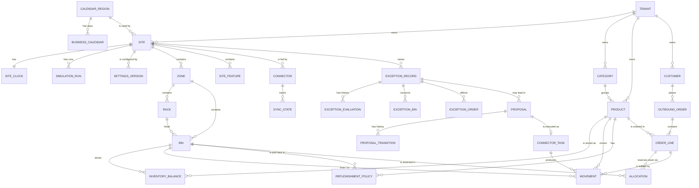

# Canonical Warehouse Model (CWM)

| | |
|---|---|
| Status | Approved (2026-11-18, revision 3) |
| Owner | Product owner |
| Last updated | 2026-11-18 |
| Implements | FR-MAP, FR-EXC, FR-FES, FR-PRP, FR-SIM, NFR-SEC-03, NFR-SEC-04, NFR-SCL-02 in [requirements.md](../product/requirements.md) |
| Related | [semantic-layer-and-query-dsl.md](semantic-layer-and-query-dsl.md) |

## 1. Purpose and scope

The CWM is the single internal model of warehouse data. Every source, the simulator in v1 and real WMS connectors later, writes into it. Every feature (map, copilot tools, semantic layer, exceptions, proposals) reads from it. Nothing above this layer knows which source produced the data.

This spec covers:

- warehouse structure and map geometry
- products, customers, outbound orders and allocations
- inventory balances and the movement ledger
- the business calendar, site clock and simulation runs
- PalletWise operational records: settings, exceptions, proposals and connector tasks
- connector sync state and data lineage
- tenancy, referential integrity and database roles

Defined in other specs: users and identity, agent registry, conversations, audit log, usage and feedback. Business calculations (available stock rules, demand, velocity, festival projection, exception rules) are defined in the semantic-layer spec, which consumes this model and does not redefine it.

## 2. Modelling conventions

| Topic | Rule |
|---|---|
| Primary keys | UUID. Connector-sourced master data uses **deterministic UUIDv5**, so re-ingesting the same source record always produces the same ID. Tenant-owned master data (categories, products, customers) derives it from `(tenant_id, source_system, entity, external_id)`. Site-scoped master data (zones, racks, bins, site features) derives it from `(tenant_id, site_id, source_system, entity, external_id)`, so the same external code at two sites never collides. All other rows use UUIDv7 (time ordered). Human-readable codes are separate, unique columns. |
| Time | All timestamps are `timestamptz` stored in UTC. Business days (operating day, "today", "yesterday") are computed in the site's time zone (`Asia/Colombo` for the v1 site). |
| "Now" | Never the database clock. Every time-based rule reads the **site clock** (section 7.3). |
| Quantities | Integer units of the product's unit of measure. No fractional units in v1. |
| Money | `numeric(14,2)` in the tenant currency (LKR for the v1 tenant). |
| Enumerations | Text columns with `CHECK` constraints, so new values are a migration, not a type change. |
| Source mapping | Every connector-sourced row has `source_system` and `external_id`, unique per tenant (master data) or per site (transactional data). Re-sending a record is therefore idempotent. |
| Lineage | Every connector-sourced row has `dataset_version` and `is_synthetic` (FR-SIM-03). |
| Deletion | The application never hard-deletes business records. Master data is deactivated with `is_active = false`. The movement ledger and all history tables are append-only. Two documented exceptions: a zero `inventory_balance` row is removed (section 8.2), and a simulation reset replaces a simulated site's connector-sourced data (section 7.4). |
| Concurrency | Mutable operational rows carry a `row_version` for optimistic locking. |
| Integrity | Every reference between tenant or site data is a composite foreign key that includes `tenant_id` and, where applicable, `site_id` (section 11.2). |

## 3. Tenancy classes

Every table belongs to exactly one class. The class decides its columns, isolation and who may write it.

| Class | Columns | Isolation | Tables |
|---|---|---|---|
| Global reference | no `tenant_id` | No RLS. Read-only to application roles. Loaded by migrations or a reference-data job. | `calendar_region`, `business_calendar` |
| Tenant-owned | `tenant_id` | RLS forced | `tenant`, `site`, `category`, `product`, `customer` |
| Site-scoped | `tenant_id`, `site_id` | RLS forced on `tenant_id`; site access decided by the policy engine | all other tables in this spec |

Reference data is not given a `tenant_id` just for uniformity. The calendar belongs to a region, not a customer.

## 4. Entity relationship overview

## 5. Structure and map geometry

All coordinates are in metres in the site's local frame: origin at the site's south-west corner, `x` east, `y` north, `z` up. The map renders directly from these values (FR-MAP-01).

### 5.1 `tenant`

| Column | Type | Notes |
|---|---|---|
| id | uuid PK | |
| code | text unique | |
| name | text | |
| currency | char(3) | `LKR` for the v1 tenant |
| is_active | boolean | |

### 5.2 `site`

| Column | Type | Notes |
|---|---|---|
| id | uuid PK | |
| tenant_id | uuid | FK `tenant` |
| code | text | unique per tenant |
| name | text | |
| region_code | text | FK `calendar_region` |
| time_zone | text | IANA name |
| width_m, depth_m | numeric | floor outline for the map |
| data_status | text | `LOADING`, `READY`, `REBUILDING`, `FAILED` |
| data_status_detail | text null | error detail when `FAILED` |
| is_active | boolean | |

Unique `(tenant_id, id)`.

**Data readiness gate.** While `data_status` is not `READY`, the site's data is incomplete. The copilot, daily brief, exception engine and task submission refuse to work on it and show a clear "data is loading" or "data is being rebuilt" status, and the map shows a banner. This applies to every source: a real connector's first load (`LOADING`) and a simulation reset (`REBUILDING`) are handled the same way, so no code checks whether data is simulated (FR-SIM-01).

### 5.3 `zone`

| Column | Type | Notes |
|---|---|---|
| id | uuid PK | |
| tenant_id, site_id | uuid | FK `site (tenant_id, id)` |
| code | text | unique per site, e.g. `A`, `B` |
| name | text | |
| zone_type | text | `FAST_PICK`, `RESERVE`, `BULK`, `COLD`, `RETURNS`, `STAGING` |
| temperature_class | text | `AMBIENT`, `CHILLED`, `FROZEN` |
| outline | jsonb | polygon `[[x,y],...]` used to draw and highlight the zone |
| is_prime | boolean | true for pick zones closest to dispatch, used by the "slow stock in prime locations" rule |
| is_active | boolean | |
| source and lineage columns | | |

Unique `(tenant_id, site_id, id)`.

### 5.4 `rack`

| Column | Type | Notes |
|---|---|---|
| id | uuid PK | |
| tenant_id, site_id, zone_id | uuid | FK `zone (tenant_id, site_id, id)` |
| code | text | unique per site, zone letter plus number, e.g. `B2` |
| origin_x, origin_y | numeric | front-left corner |
| rotation_deg | numeric | `0`, `90`, `180`, `270` in v1 |
| bay_count, level_count | int | `> 0` |
| bay_width_m, depth_m, level_height_m | numeric | `> 0` |
| is_active | boolean | |
| source and lineage columns | | |

Unique `(tenant_id, site_id, zone_id, id)`, so a bin can prove its rack is in its own zone.

**Levels are attributes, not a table.** A level has no independent data in v1, so it is represented by `rack.level_count`, `rack.level_height_m` and `bin.level`. A `rack_level` table can be added later if per-level weight limits are needed.

### 5.5 `bin`

The smallest storage location. A bin either belongs to a rack (bay and level) or is a floor position in a bulk or staging zone (no rack).

| Column | Type | Notes |
|---|---|---|
| id | uuid PK | |
| tenant_id, site_id, zone_id | uuid | FK `zone (tenant_id, site_id, id)` |
| rack_id | uuid null | FK `rack (tenant_id, site_id, zone_id, id)`; null for floor positions |
| code | text | unique per site. Rack bins: `{rack}-{bay:02}-{level:02}`, e.g. `B2-03-02`. Floor bins: `{zone}-F{nn}` |
| bay, level | int null | required when `rack_id` is set; `1 <= bay <= rack.bay_count` and `1 <= level <= rack.level_count`, enforced by a trigger |
| bin_role | text | `PICK`, `RESERVE`, `BULK`, `STAGING`, `RETURNS`, `RECEIVING` |
| x, y, z | numeric | centre of the bin |
| width_m, depth_m, height_m | numeric | `> 0` |
| capacity_volume_m3 | numeric | `> 0` |
| capacity_weight_kg | numeric | `> 0` |
| single_sku | boolean | true for pick faces |
| is_active | boolean | |
| source and lineage columns | | |

Constraints: `CHECK ((rack_id IS NULL) = (bay IS NULL AND level IS NULL))`. Unique `(tenant_id, site_id, id)`.

### 5.6 `site_feature`

Non-storage map elements, used only for drawing and context.

| Column | Type | Notes |
|---|---|---|
| id | uuid PK | |
| tenant_id, site_id | uuid | FK `site` |
| feature_type | text | `RECEIVING_DOCK`, `SHIPPING_DOCK`, `AISLE`, `OFFICE`, `WALL` |
| label | text | |
| outline | jsonb | polygon |

## 6. Products, customers, orders and allocations

### 6.1 `category`

| Column | Type | Notes |
|---|---|---|
| id | uuid PK | |
| tenant_id | uuid | FK `tenant` |
| code, name | text | code unique per tenant |
| source and lineage columns | | |

Unique `(tenant_id, id)`.

### 6.2 `product`

| Column | Type | Notes |
|---|---|---|
| id | uuid PK | |
| tenant_id | uuid | |
| sku | text | unique per tenant, e.g. `SKU-102` |
| name | text | treated as untrusted text by the copilot (FR-COP-12) |
| category_id | uuid | FK `category (tenant_id, id)` |
| brand | text | `Fresh`, `Style` or `Tech` in v1, matching `outlets.csv` brands |
| uom | text | `EA`, `CASE` |
| unit_volume_m3, unit_weight_kg | numeric | `> 0` |
| unit_value | numeric(14,2) | cost value per unit, used for value at risk |
| temperature_class | text | must match the zone's class for putaway (enforced by the source) |
| is_active | boolean | |
| source and lineage columns | | |

Unique `(tenant_id, id)`.

### 6.3 `customer`

Outbound destinations. In v1 these are the outlets from `General Data/outlets.csv`.

| Column | Type | Notes |
|---|---|---|
| id | uuid PK | |
| tenant_id | uuid | |
| code | text | unique per tenant, e.g. `OUT001` |
| brand | text | |
| district | text | |
| dock_type | text | `street`, `rear_dock`, `mall_bay` |
| parking_constraint | text null | |
| window_open, window_close | time | delivery window in site local time |
| source and lineage columns | | |

Unique `(tenant_id, id)`.

### 6.4 `outbound_order`

| Column | Type | Notes |
|---|---|---|
| id | uuid PK | |
| tenant_id, site_id | uuid | FK `site` |
| order_no | text | unique per site |
| customer_id | uuid | FK `customer (tenant_id, id)` |
| delivery_date | date | site local date |
| dispatch_deadline | timestamptz | delivery window open on `delivery_date` minus the site's dispatch lead time setting, fixed when the order is created |
| status | text | `OPEN`, `ALLOCATED`, `PICKING`, `PICKED`, `SHIPPED`, `CANCELLED` |
| shipped_at | timestamptz null | |
| source and lineage columns | | |

Unique `(tenant_id, site_id, id)`.

### 6.5 `order_line`

| Column | Type | Notes |
|---|---|---|
| id | uuid PK | |
| tenant_id, site_id, order_id | uuid | FK `outbound_order (tenant_id, site_id, id)` |
| line_no | int | unique per order |
| product_id | uuid | FK `product (tenant_id, id)` |
| qty_ordered | int | `> 0` |
| qty_allocated | int | projection: sum of `allocation.qty - allocation.qty_released` for this line |
| qty_picked | int | projection: sum of `allocation.qty_consumed` for this line |
| qty_shipped | int | from `SHIP` movements |

Constraints: `qty_shipped <= qty_picked <= qty_allocated <= qty_ordered`. Unique `(tenant_id, site_id, id)` and `(tenant_id, site_id, id, product_id)`, the second so an allocation can prove it reserves the line's own product.

### 6.6 `allocation`

Stock reserved for an order line in a specific bin. Allocation is decided by the WMS (the simulator in v1) and arrives through the connector. PalletWise does not allocate stock.

| Column | Type | Notes |
|---|---|---|
| id | uuid PK | |
| tenant_id, site_id | uuid | |
| order_line_id, product_id | uuid | FK `order_line (tenant_id, site_id, id, product_id)`, so the product always equals the line's product |
| bin_id | uuid | FK `bin (tenant_id, site_id, id)` |
| qty | int | `> 0`, quantity originally reserved; never changed after creation |
| qty_consumed | int | `>= 0`; picked quantity: increased by `PICK`, decreased by `PICK_REVERSAL` |
| qty_released | int | `>= 0`; unpicked quantity given back (cancellation or reallocation) |
| status | text | **generated**: `ACTIVE` when `qty - qty_consumed - qty_released > 0`, otherwise `CONSUMED` if `qty_consumed > 0`, otherwise `RELEASED` |
| created_at, closed_at | timestamptz | `closed_at` set when the remainder reaches 0, cleared if a reversal reopens it |
| row_version | int | |
| source and lineage columns | | |

Constraint: `qty_consumed + qty_released <= qty`.

**Active reserved quantity** = `qty - qty_consumed - qty_released`.

**Rules**, all enforced inside `apply_movement()` and `apply_allocation()`:

| Event | Effect, in one transaction |
|---|---|
| Allocation created | `allocation` inserted; `inventory_balance.allocated` of its bin increases by `qty` |
| Release | only the unpicked remainder can be released: `qty_released` increases by at most the active reserved quantity; `allocated` decreases by the same amount. Already-picked units stay picked, so `order_line.qty_picked` never drops because of a release. |
| `PICK` | requires an `ACTIVE` allocation for the same order line and bin with enough remainder. `on_hand` of the pick bin decreases, `on_hand` of the staging bin increases, `qty_consumed` increases and `allocated` of the pick bin decreases, all by the picked quantity. |
| `PICK_REVERSAL` | must return stock to the bin of the allocation it reverses, and cannot exceed that allocation's `qty_consumed`. `on_hand` of staging decreases, `on_hand` of the allocation's bin increases, `qty_consumed` decreases and `allocated` of that bin increases. A WMS that returns stock elsewhere sends a reversal followed by a `TRANSFER`. |

Because status is derived from the quantities, it can never disagree with them.

## 7. Calendar, clock and simulation runs

### 7.1 `calendar_region` (global reference)

| Column | Type | Notes |
|---|---|---|
| region_code | text PK | `LK` for v1 |
| name | text | |
| coverage_start, coverage_end | date | first and last date present in `business_calendar` for the region |

### 7.2 `business_calendar` (global reference)

Loaded from `General Data/calendar.csv` without transformation.

| Column | Type | Source column |
|---|---|---|
| region_code | text | FK `calendar_region`; constant `LK` |
| date | date | `date` |
| dow | smallint | `dow` (0 = Monday) |
| is_weekend | boolean | `is_weekend` |
| iso_year, iso_week | smallint | `iso_year`, `iso_week` |
| is_payday | boolean | `is_payday` |
| festival | text null | `festival` (set on the festival day only) |
| festival_ramp | numeric(3,2) | `festival_ramp`, 0.0 to 1.0, rising over the 10 days before a festival |
| is_holiday | boolean | `is_holiday` |
| is_monsoon | boolean | `monsoon` |
| is_operating | boolean | `is_operating` |

Primary key `(region_code, date)`. Coverage in v1: 2024-01-01 to 2026-06-28. A loader test checks row count and values against the file (FR-FES-01), and that `calendar_region.coverage_start` and `coverage_end` match.

### 7.3 `site_clock`

The single source of "now" for a site.

| Column | Type | Notes |
|---|---|---|
| site_id | uuid PK | FK `site (tenant_id, id)` with `tenant_id` |
| tenant_id | uuid | |
| mode | text | `SIMULATED` or `REAL` |
| sim_time | timestamptz null | current simulated time, required when `SIMULATED` |
| speed | int | `1`, `10`, `60` |
| state | text | `RUNNING`, `PAUSED` |
| row_version | int | |

For `REAL`, "now" is the wall clock. For `SIMULATED`, "now" is `sim_time`, advanced only by the simulator, always within the site region's calendar coverage (FR-SIM-05). Clock jumps move forward only (FR-SIM-09).

### 7.4 `simulation_run` and reset

A **reset is not a clock jump.** It ends the current simulation run and starts a new one from the seed.

| Column | Type | Notes |
|---|---|---|
| id | uuid PK | |
| tenant_id, site_id | uuid | FK `site` |
| seed | bigint | |
| dataset_version | text | |
| clock_start | timestamptz | simulated time at which the run starts |
| status | text | `BUILDING`, `ACTIVE`, `ENDED`, `FAILED` |
| started_at, ended_at | timestamptz | wall-clock time |
| started_by | text | identity-provider subject of the Admin |
| scenario_log | jsonb | ordered external inputs applied during the run (scenario events, executed tasks, parameter changes), with the simulated time of each; seed plus this log reproduce the run exactly |

At most one run per site in `BUILDING` or `ACTIVE` (unique partial index).

**Why runs do not tag every row.** The simulator is deterministic: the seed plus the scenario log reproduce a run exactly. Keeping an old run's movements would add nothing that cannot be regenerated, and tagging every row with a run would force every query to filter by run. Instead, a reset replaces the site's connector-sourced transactional data, and only PalletWise's own records keep a `simulation_run_id`.

**Reset lifecycle.** The old run goes `ACTIVE` to `ENDED`; the new run goes `BUILDING` to `ACTIVE`, or to `FAILED`.

*Step 1, one transaction*, executed by `reset_simulated_site(site_id)`, which refuses unless `site_clock.mode = 'SIMULATED'`:

1. Set `site.data_status = 'REBUILDING'`. From this moment the data readiness gate (section 5.2) applies.
2. Set every `PENDING` proposal to `EXPIRED` and every `SUBMITTED` task and its proposal to `FAILED`, all with code `SIMULATION_RESET`, recorded as system transitions.
3. Resolve every open exception with `resolution_reason = 'SIMULATION_RESET'`.
4. Delete the site's movements, inventory balances, allocations, order lines and orders, and reset `sync_state`. Links in `exception_order` keep their `order_no` snapshot; their `order_id` is set to null by the foreign key (section 9.2).
5. Keep master data. Because its IDs are deterministic, the regenerated master data has the same IDs, so proposals, exceptions and audit entries still point at valid bins and products.
6. End the current run and insert a new run with status `BUILDING`. Set `site_clock.sim_time` to its `clock_start` and `state` to `PAUSED`.
7. Write an audit entry.

*Step 2, regeneration*: the simulator regenerates history from the seed through the normal ingestion path. The connector rejects every task while the run is `BUILDING`, and any task whose `simulation_run_id` is not the active run, so no stale task can execute (FR-SIM-09).

*Step 3, completion*: when regeneration finishes and the dataset hash matches the expected hash for the seed, one transaction refreshes the planner statistics of the loaded tables and sets the run to `ACTIVE` and `site.data_status = 'READY'`, so the first questions after a load do not run on plans made without statistics. If regeneration fails, the run becomes `FAILED`, `site.data_status = 'FAILED'` with the error detail, and the Admin can start the reset again. A failed reset never leaves partial data looking complete.

## 8. Inventory

### 8.1 `movement` (the ledger)

Every change in physical stock is a movement. Movements are append-only and are the source of truth for on-hand quantity, history, velocity and dead-stock rules.

| Column | Type | Notes |
|---|---|---|
| id | uuid PK | UUIDv7 |
| tenant_id, site_id | uuid | |
| movement_type | text | see table below |
| product_id | uuid | FK `product (tenant_id, id)` |
| qty | int | always `> 0`; direction comes from the bins |
| from_bin_id | uuid null | FK `bin (tenant_id, site_id, id)` |
| to_bin_id | uuid null | FK `bin (tenant_id, site_id, id)` |
| occurred_at | timestamptz | when it happened at the source (site clock time for the simulator) |
| recorded_at | timestamptz | when PalletWise stored it |
| order_line_id | uuid null | FK `order_line (tenant_id, site_id, id)`; required for `PICK` and `SHIP` |
| task_id | uuid null | FK `connector_task (tenant_id, site_id, id)`; set when produced by a connector task |
| idempotency_key | text null | the task's idempotency key when produced by a task |
| reason_code | text null | required for `ADJUSTMENT`; `PICK_REVERSAL` for reversed picks |
| source and lineage columns | | |

Unique `(tenant_id, site_id, source_system, external_id)` for idempotent sync, and unique `(tenant_id, site_id, idempotency_key)` where `idempotency_key` is not null (FR-PRP-10).

| Type | from_bin | to_bin | Meaning |
|---|---|---|---|
| `RECEIPT` | null | receiving bin | goods arrive |
| `PUTAWAY` | receiving bin | storage bin | stored |
| `REPLENISH` | reserve or bulk bin | pick bin | pick face refilled (a distinct type, not a `TRANSFER` subtype) |
| `TRANSFER` | bin | bin | other internal move; with `reason_code = 'PICK_REVERSAL'` and `order_line_id` set, returns picked stock from staging to the bin of the allocation it reverses (section 6.6) |
| `PICK` | pick bin | staging bin | picked for an order line; consumes its allocation (section 6.6) |
| `SHIP` | staging bin | null | leaves the site |
| `ADJUSTMENT` | see rule | see rule | count correction. Positive correction: `to_bin_id` set, `from_bin_id` null. Negative correction: `from_bin_id` set, `to_bin_id` null. Reason required. |

Constraints: a `CHECK` per type enforcing which bin columns are null or set; `from_bin_id <> to_bin_id`.

**Demand semantics, for the semantic layer.** Demand is counted from `PICK` movements whose order is not `CANCELLED`, minus `PICK_REVERSAL` transfers for the same order line. `SHIP` is never counted as demand, so nothing is counted twice. The exact calculation is defined in the semantic-layer spec.

**Indexes.** `(site_id, product_id, occurred_at)`, `(site_id, from_bin_id, occurred_at)`, `(site_id, to_bin_id, occurred_at)`, `(site_id, movement_type, occurred_at)`, `(site_id, order_line_id)`.

**No partitioning in v1.** PostgreSQL requires every unique key on a partitioned table to include the partition column, which conflicts with the primary key and idempotency key above. At v1 volumes an indexed table is sufficient. Partitioning is revisited only with measured workload data, and then the key and foreign-key strategy is redesigned together in an ADR.

### 8.2 `inventory_balance`

The current physical and reserved quantity of a product in a bin. It is a projection, never written directly. It changes only inside the database functions `apply_movement()` and `apply_allocation()`, in the same transaction as the ledger or allocation change, so they can never disagree. `apply_movement()` owns every effect of a movement, including the allocation effects of `PICK` and `PICK_REVERSAL`; `apply_allocation()` owns allocation creation and release. The two never update the same allocation for the same event.

| Column | Type | Notes |
|---|---|---|
| tenant_id, site_id | uuid | |
| bin_id | uuid | FK `bin (tenant_id, site_id, id)` |
| product_id | uuid | FK `product (tenant_id, id)` |
| on_hand | int | `>= 0`; sum moved in minus sum moved out over all movements |
| allocated | int | `>= 0`, `<= on_hand`; sum of active reserved quantity of allocations for this bin and product |
| available | int | generated: `on_hand - allocated` |
| last_movement_at | timestamptz | |
| row_version | int | |

Primary key `(tenant_id, site_id, bin_id, product_id)`.

**Semantics**

- A row with `on_hand = 0` (and therefore `allocated = 0`) is removed, so the presence of a row means stock is present. Removing a balance row never removes movements or allocations: the ledger keeps the full history.
- A bin with `single_sku = true` may hold at most one product, enforced in `apply_movement()`.
- A movement that would make `on_hand` negative, or `allocated` greater than `on_hand`, is rejected.
- A nightly reconciliation job recomputes `on_hand` from the ledger and `allocated` from allocations, and raises an alert on any difference. A difference is a defect, never silently corrected.
- WMS sources that provide balance snapshots instead of movements post the difference as an `ADJUSTMENT` with `reason_code = 'SNAPSHOT_RECONCILE'`, so the ledger stays complete.

### 8.3 `replenishment_policy`

| Column | Type | Notes |
|---|---|---|
| id | uuid PK | |
| tenant_id, site_id | uuid | |
| product_id | uuid | FK `product (tenant_id, id)` |
| pick_bin_id | uuid | FK `bin (tenant_id, site_id, id)`; must be a `PICK` bin (checked on write and tested) |
| min_qty, max_qty | int | `0 <= min_qty < max_qty` |
| source and lineage columns | | |

Unique `(site_id, product_id, pick_bin_id)`.

## 9. PalletWise operational records

Written by PalletWise services, never by connectors.

### 9.1 `settings_version`

Versioned Admin settings per site (FR-ADM-04). A new version is a new row; the highest `version_no` for the site is in effect. A new site starts with a copy of an existing site's settings.

| Column | Type | Notes |
|---|---|---|
| id | uuid PK | |
| tenant_id, site_id | uuid | FK `site` |
| version_no | int | unique per site, increasing |
| schema_version | int | version of the settings schema that `values` conforms to |
| values | jsonb | validated against `schema_version` before insert |
| created_by | text | identity-provider subject |
| created_at | timestamptz | |
| note | text | |

`values` contains: low-stock rules, dead-stock period in days, exception ranking weights, category festival uplift (map of category id to percent, default 0), proposal expiry, dispatch lead time in minutes, trailing demand window in operating days.

### 9.2 Exceptions

**`exception_record`**

| Column | Type | Notes |
|---|---|---|
| id | uuid PK | |
| tenant_id, site_id | uuid | |
| simulation_run_id | uuid null | FK `simulation_run`; set on simulated sites |
| exception_type | text | `STOCKOUT_RISK`, `DELAYED_ORDER`, `LOW_STOCK`, `DEAD_STOCK`, `SLOW_IN_PRIME`, `CAPACITY_HOTSPOT`, `FESTIVAL_SHORTAGE` |
| subject_key | text | stable key, e.g. `product:<id>:bin:<id>` or `order:<id>` |
| product_id | uuid null | FK `product`, when the exception is about a product |
| status | text | `OPEN`, `ACKNOWLEDGED`, `RESOLVED` |
| resolution_reason | text null | `CONDITION_CLEARED`, `SIMULATION_RESET` |
| score | numeric | latest impact score |
| score_components | jsonb | normalized components and weights (FR-EXC-02) |
| settings_version_id | uuid | FK `settings_version`, used for the latest score |
| first_detected_at, last_evaluated_at, resolved_at | timestamptz | |
| acknowledged_by, acknowledged_at | | |
| row_version | int | |

Unique partial index: one non-resolved record per `(site_id, exception_type, subject_key)`.

**`exception_bin`** links an exception to the bins it concerns. Primary key `(exception_id, bin_id)`, composite foreign keys to both.

**`exception_order`** links an exception to the orders it affects: `id` (primary key), `exception_id`, `order_id` (nullable), `order_no` (snapshot, always kept). The foreign key to `outbound_order` uses `ON DELETE SET NULL (order_id)`, so a simulation reset keeps the historical link readable through `order_no` while the order itself is replaced. Unique `(exception_id, order_no)`.

**`exception_evaluation`** keeps every evaluation: `exception_id`, `evaluated_at`, `score`, `score_components`, `settings_version_id`. Append-only.

### 9.3 Proposals

**`proposal`**

| Column | Type | Notes |
|---|---|---|
| id | uuid PK | |
| tenant_id, site_id | uuid | |
| simulation_run_id | uuid null | FK `simulation_run` |
| proposal_type | text | `REPLENISHMENT`, `CYCLE_COUNT` |
| status | text | `PENDING`, `APPROVED`, `REJECTED`, `EXPIRED`, `SUBMITTED`, `EXECUTED`, `FAILED` |
| product_id | uuid null | FK `product`; required for `REPLENISHMENT` |
| from_bin_id | uuid null | FK `bin`; required for `REPLENISHMENT` |
| to_bin_id | uuid null | FK `bin`; required for `REPLENISHMENT` |
| target_bin_id | uuid null | FK `bin`; required for `CYCLE_COUNT` |
| qty | int null | `> 0`; required for `REPLENISHMENT` |
| evidence_snapshot | jsonb | data that justified the draft (FR-PRP-02), immutable |
| requested_by | text | Manager on whose behalf it was drafted |
| drafted_by_agent_id, drafted_by_agent_version | text | |
| conversation_id | uuid null | |
| exception_id | uuid null | FK `exception_record` |
| expires_at | timestamptz | site clock time |
| decided_by, decided_at, rejection_reason | | |
| failure_code, failure_detail | text null | `STALE`, `INSUFFICIENT_STOCK`, `CAPACITY_EXCEEDED`, `BIN_UNAVAILABLE`, `CONNECTOR_ERROR`, `SIMULATION_RESET` |
| row_version | int | |

`CHECK` constraints enforce which typed columns are required per `proposal_type`. Operational targets are typed columns with foreign keys; only the evidence snapshot is JSON. Targets are validated against current data before approval (FR-PRP-05) and again by the connector before execution (FR-PRP-09).

**Staleness.** The evidence snapshot records the balances of the involved bins and products and the `settings_version_id` used. At approval:

- if any recorded balance differs from the current balance, the proposal is stale: the Manager sees the difference and must confirm again (FR-PRP-05);
- if only the settings version changed, the Manager sees a notice, but approval is not blocked, because settings do not change physical stock.

**`proposal_transition`** records every status change: `proposal_id`, `from_status`, `to_status`, `actor_type` (`USER`, `SYSTEM`, `CONNECTOR`), `actor_id`, `at`, `reason`. Append-only. Allowed transitions are enforced by the workflow functions (section 11.3) and by a trigger as a second line of defence.

### 9.4 `connector_task`

| Column | Type | Notes |
|---|---|---|
| id | uuid PK | |
| tenant_id, site_id | uuid | |
| simulation_run_id | uuid null | FK `simulation_run`; the connector rejects a task from an ended run |
| proposal_id | uuid | FK `proposal`, unique: one task per proposal |
| connector_id | uuid | FK `connector` |
| idempotency_key | text | unique per site; generated once at approval and reused on every retry |
| status | text | `SUBMITTED`, `EXECUTED`, `FAILED` |
| submitted_at, completed_at | timestamptz | |
| result | jsonb null | e.g. counted quantity for cycle counts |
| failure_code, failure_detail | text null | |

Movements produced by the task carry its `task_id` and `idempotency_key`. A retry with the same key returns the stored result and creates no movement (FR-PRP-10).

## 10. Connectors, sync and freshness

### 10.1 `connector` (site-scoped)

| Column | Type | Notes |
|---|---|---|
| id | uuid PK | |
| tenant_id, site_id | uuid | FK `site` |
| connector_type | text | `SIMULATOR` in v1 |
| status | text | `ACTIVE`, `PAUSED`, `ERROR` |
| config_ref | text | reference to configuration in the secret store; never secrets in the row |

### 10.2 `sync_state`

| Column | Type | Notes |
|---|---|---|
| connector_id, stream | | primary key; streams: `MASTER`, `MOVEMENTS`, `ORDERS`, `ALLOCATIONS` |
| tenant_id, site_id | uuid | |
| cursor | text | source position for incremental sync |
| last_success_at | timestamptz | |
| data_as_of | timestamptz null | latest source time included; null means the stream has never synced |

**Freshness shown on an answer** is the oldest `data_as_of` among the streams the answer used (FR-COP-04). A stream with `data_as_of` null is **unavailable**, never fresh: an answer that needs it is declined with "this data has not been loaded yet", and a site with any required stream never synced cannot be `READY`.

## 11. Isolation, integrity and database roles

### 11.1 Row-level security

- Every tenant-owned and site-scoped table has `ENABLE` and `FORCE ROW LEVEL SECURITY`, so policies also apply to the table owner and to functions running as the owner.
- Policy: `tenant_id = current_setting('app.tenant_id')::uuid`. If the setting is missing, `current_setting` raises an error, so a request without tenant context fails closed.
- The API sets the context with `set_config('app.tenant_id', $1, true)` at the start of every transaction. The `true` makes it transaction-local, so pooled connections cannot carry it into another request.
- Site access is decided by the policy engine before any query. RLS enforces the tenant boundary.

### 11.2 Composite foreign keys

Every parent table that is referenced exposes a composite unique key, and every reference uses it:

| Child | References |
|---|---|
| `site` | `calendar_region (region_code)` |
| `zone`, `site_feature`, `connector`, `settings_version`, `simulation_run`, `site_clock` | `site (tenant_id, id)` |
| `rack` | `zone (tenant_id, site_id, id)` |
| `bin` | `zone (tenant_id, site_id, id)` and `rack (tenant_id, site_id, zone_id, id)` |
| `product` | `category (tenant_id, id)` |
| `outbound_order` | `site (tenant_id, id)`, `customer (tenant_id, id)` |
| `order_line` | `outbound_order (tenant_id, site_id, id)`, `product (tenant_id, id)` |
| `allocation` | `order_line (tenant_id, site_id, id, product_id)`, `bin (tenant_id, site_id, id)` |
| `inventory_balance`, `replenishment_policy` | `bin (tenant_id, site_id, id)`, `product (tenant_id, id)` |
| `movement` | `bin (tenant_id, site_id, id)` for both bins, `product (tenant_id, id)`, `order_line (tenant_id, site_id, id)`, `connector_task (tenant_id, site_id, id)` |
| `exception_record` | `site`, `product`, `settings_version (tenant_id, site_id, id)`, `simulation_run (tenant_id, site_id, id)` |
| `exception_bin`, `exception_order` | `exception_record (tenant_id, site_id, id)` and `bin` or `outbound_order` |
| `proposal` | `bin` for each bin column, `product`, `exception_record`, `simulation_run`, all with `(tenant_id, site_id, ...)` |
| `connector_task` | `proposal (tenant_id, site_id, id)`, `connector (tenant_id, site_id, id)`, `simulation_run` |
| `sync_state` | `connector (tenant_id, site_id, id)` |

A row can never point at another tenant's or another site's data, even through a bug in application code.

### 11.3 Database roles and write paths

Each write path has exactly one role. Writes that must keep invariants go through `SECURITY DEFINER` functions owned by `pw_owner`; the calling role can execute the function but cannot write the table directly. Because RLS is forced, the functions still respect tenant isolation.

| Role | Used by | Can | Cannot |
|---|---|---|---|
| `pw_owner` | migrations only | own schema and functions | be used at runtime |
| `pw_ingest` | connector ingestion | upsert master data and orders; execute `apply_movement()` and `apply_allocation()`; update `sync_state` | write `inventory_balance` directly; touch proposals, tasks, settings, exceptions |
| `pw_app` | API (reads, settings, acknowledgements) | read operational tables; insert `settings_version`; execute `acknowledge_exception()` | write inventory, proposals, tasks or audit |
| `pw_evaluator` | exception engine | write `exception_record`, links and evaluations | anything else |
| `pw_proposal_writer` | propose tools | insert `proposal` and its first transition, only with status `PENDING` (enforced by RLS `WITH CHECK`) | update or approve |
| `pw_workflow` | proposal service | execute `transition_proposal()`, `submit_task()`, `record_task_result()` | insert movements (they arrive through ingestion), change inventory directly |
| `pw_sim_admin` | simulation admin service | execute `reset_simulated_site()` | anything else |
| `pw_agent_read` | read tools and query language | `SELECT` on views and `EXECUTE` on functions in the `sem` schema only (semantic-layer spec) | read raw tables, write anything |
| `pw_memory` | conversation store (other spec) | read and write conversation tables | anything else |

None of the roles has `BYPASSRLS`. Privilege tests run as each role.

### 11.4 Hardening of privileged functions

Every `SECURITY DEFINER` function must follow these rules, checked by an automated test that inspects the database catalog:

- `pw_owner` is a non-login role without `BYPASSRLS` and is not a superuser. Migrations run as a login role that is a member of `pw_owner` and uses `SET ROLE`.
- Each function declares a fixed `search_path` (`SET search_path = pw, pg_temp`) and schema-qualifies the objects it uses.
- `EXECUTE` is revoked from `PUBLIC` and granted only to the role listed in section 11.3.
- Each function first checks that `app.tenant_id` is set and that every row it touches belongs to that tenant, even though RLS also enforces it.
- No dynamic SQL built from input. Inputs are typed parameters.

## 12. Data volumes (v1 simulated site)

| Entity | Approximate rows |
|---|---|
| zones | 6 |
| racks | 30 |
| bins | 600 |
| products | 300 |
| customers | 120 (from `outlets.csv`) |
| orders | about 15,000 over 180 days |
| allocations | about 60,000 over 180 days |
| movements | about 400,000 over 180 days |

The schema and indexes are sized for 10,000 bins and several million movements per site (NFR-SCL-03) without partitioning.

## 13. Tests required by this spec

| Test | Expected result |
|---|---|
| Calendar loader | Matches `calendar.csv` exactly; region coverage matches |
| Calendar region | A site cannot reference a region that does not exist |
| `CHECK` rules | Every invalid movement direction, proposal shape and quantity relation is rejected |
| Ledger consistency | After every simulator run, balances equal the ledger; reconciliation detects an injected difference |
| Allocation consistency | `allocated` equals active reserved quantity; `allocated > on_hand` is rejected; an allocation for a different product than its line is rejected |
| Release after partial pick | Allocate 10, pick 6, release: `qty_released = 4`, `qty_picked` stays 6, line constraints hold |
| Pick reversal | Allocate 10, pick 6, reverse 2: `qty_consumed = 4`, stock back in the allocation's bin, allocation `ACTIVE` again; reversing more than consumed, or into another bin, is rejected |
| Site-scoped deterministic IDs | The same external bin code at two sites produces two different IDs |
| Bin bounds | A bin with a bay or level outside its rack is rejected |
| Data readiness | While `data_status` is not `READY`, copilot, brief, exception engine and task submission refuse with a clear status |
| Never-synced stream | A null `data_as_of` is reported as unavailable, never as fresh |
| Function hardening | Catalog test: fixed `search_path`, no `PUBLIC` execute, owner without login, `BYPASSRLS` or superuser |
| Negative stock | A movement that would make `on_hand` negative is rejected |
| PICK and SHIP | Demand is counted once; a pick reversal reduces it |
| Composite keys | A bin referencing a rack in another zone or site, and any cross-tenant reference, is rejected |
| RLS | A second tenant's rows are invisible to every runtime role, including with pooled connections; missing tenant context fails |
| Roles | Each role can do exactly what section 11.3 allows; direct writes to `inventory_balance` fail |
| Task idempotency | Replaying a task with the same key creates no movement and no balance change |
| Sync idempotency | Re-sending the same source record creates no duplicate |
| Reset | New run is `BUILDING` then `ACTIVE`; pending proposals expired and submitted tasks failed with `SIMULATION_RESET`; histories, audit and `exception_order.order_no` kept; master data IDs unchanged; refused on a `REAL` site; a failed regeneration leaves the run and site `FAILED` |
| Stale task after reset | A task from an ended run is rejected by the connector |
| Determinism | Two runs from the same seed produce the same dataset hash |

## 14. Decisions

| # | Decision | Status |
|---|---|---|
| 1 | Levels are rack and bin attributes, not a table | Approved by review |
| 2 | A balance row is removed at zero; the ledger keeps history | Approved by review |
| 3 | Snapshot-based sources reconcile through `ADJUSTMENT` movements | Approved by review |
| 4 | Bin codes follow `{rack}-{bay}-{level}`, e.g. `B2-03-02` | Approved by review |
| 5 | Dispatch deadline = delivery window open minus dispatch lead time | Approved by review |
| 6 | Demand is measured from `PICK` movements, minus pick reversals, never from `SHIP` | Approved by review, clarified |
| 7 | No partitioning of `movement` in v1 | Approved by review |
| 8 | Allocation is source data from the WMS, stored in `allocation`; balances project it | Approved by review |
| 9 | Reset replaces a simulated site's connector-sourced data; deterministic master-data IDs; `simulation_run_id` only on PalletWise records | Approved by review, with `BUILDING` lifecycle added |
| 10 | Settings are site-scoped, with no tenant-level defaults in v1 | Approved by review |
| 11 | `calendar_region` table as the target of `site.region_code` | Approved by review |
| 12 | Proposal targets are typed columns with foreign keys; only evidence is JSON | Approved by review |
| 13 | One database role per write path, invariant writes only through hardened owner functions | Approved by review, hardening added (section 11.4) |
| 14 | Data readiness is a site-level `data_status` gate for every source, not a check on the simulation run | New, for approval |
| 15 | Allocation status is generated from quantities; release gives back only the unpicked remainder | New, for approval |

## 15. Change log

| Date | Change |
|---|---|
| 2026-11-18 | First draft. |
| 2026-11-18 | Revision 2 after review: removed partitioning; added `allocation`, `calendar_region`, `simulation_run` and reset procedure, `exception_bin` and `exception_order`; deterministic master-data IDs; connector and settings made site-scoped; typed proposal targets; complete composite foreign keys; demand, adjustment and pick-reversal semantics; write-path roles and functions; extended tests. |
| 2026-11-18 | Revision 3 after review: site identity in deterministic IDs for site-scoped master data; `qty_released`, generated allocation status and exact PICK, reversal and release rules; allocation-to-line product FK; `site.data_status` readiness gate and `BUILDING` reset lifecycle; `exception_order` survives reset; trigger for bin bounds; settings `schema_version`; staleness rule; never-synced streams; hardening of privileged functions (11.4); extended tests. |
| 2026-11-18 | Corrections after approval (data facts, no design change): product brands include `Tech`; `scenario_log` holds every external input of a run, including executed tasks. |
| 2026-11-20 | Slice 2 step 7 finding: completing a load refreshes planner statistics before the site is `READY` (7.4 step 3, migration `0016_load_statistics`). Without them, a rule such as top movers took 3.7 s under the agent role right after a load and was cancelled by the 3 s statement timeout; with them it takes 0.01 s. `pw.complete_load` already runs as the tables' owner, so no role gains a privilege. |
| 2026-11-20 | Slice 3 step 1 (migration `0021_exceptions`, slice-3-acceptance 2.3 and 2.4): `exception_record` gains `zone_id` and `order_id` (subjects that are a zone or an order) and `critical` (severity per agent spec 10); `exception_evaluation` gains `event` (`OPENED`, `RESCORED`, `ACKNOWLEDGED`, `RESOLVED`) and `status`, so one append-only table holds each exception's history; new table `exception_engine_state` holds each site's last evaluation key. `pw_evaluator` reads `sem` and writes these tables only; it has no TEMP privilege, so the evaluation passes its candidate set as a typed array. |
